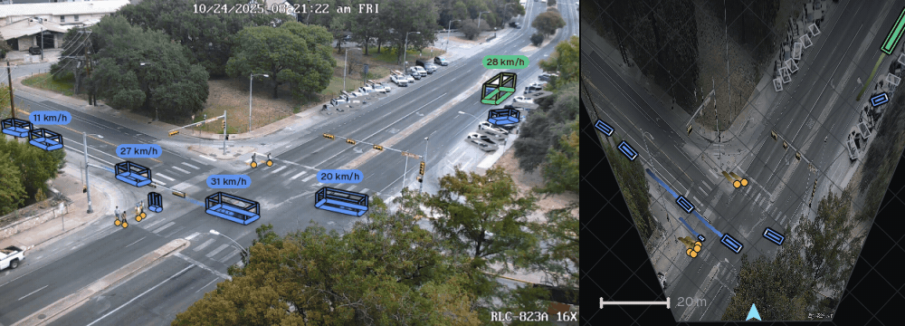

<p align="center">
  
</p>

<h1 align="center">Tachymetry</h1>

<p align="center">
  <b>Metric trajectories, speeds and counts from traffic-camera video.</b><br/>
  Detection, multi-object tracking, camera calibration and bird's-eye view, with batch processing on multiple GPUs.
</p>

<p align="center">
  <a href="https://mehmetkeremturkcan.com/">Mehmet Kerem Turkcan</a><br/>
  Associate Research Scientist, Department of Civil Engineering, Columbia University
</p>

<p align="center">
  <a href="https://mkturkcan.github.io/tachymetry/"></a>
  <a href="https://mkturkcan.github.io/tachymetry/docs/"></a>
  <a href="https://huggingface.co/facebook/sam3"></a>
  <a href="https://github.com/mkturkcan/tachymetry/actions/workflows/ci.yml"></a>
  
  
  <a href="LICENSE"></a>
</p>

---

## Install

```bash
pip install git+https://github.com/mkturkcan/tachymetry
```

Python 3.10 or newer. On Windows with an NVIDIA GPU, install the CUDA build of PyTorch first, for example `pip install torch --index-url https://download.pytorch.org/whl/cu128`. The default detector, SAM 3, is gated on Hugging Face: request access at [facebook/sam3](https://huggingface.co/facebook/sam3), then run `hf auth login`. Weights download on first use.

## Quick start

```bash
tachymetry demo                          # downloads a public intersection clip and runs the pipeline
tachymetry run videos/ --render          # all videos in a folder, in parallel on the available GPUs
```

```python
import tachymetry as tm

run = tm.track("clip.mp4", out="runs/clip", render=True)   # detect, calibrate, track, export, render
print(run.summary())                                        # counts by class, moving vs parked, speeds
df = run.tracks.to_dataframe()                              # one row per object and frame, in metres
```

Each run directory contains `tracks.csv` (positions in metres, speeds, headings, boxes), `tracks_summary.csv` (one row per road user), `camera.json`, a calibration preview, and `overlay.mp4` when rendering.

## Examples

**Batch processing.** Inputs can be files, folders or glob patterns. Worker processes are planned from the free memory of each device, finished videos are skipped on re-runs, and a failing video is logged without stopping the batch. The scheduler uses spawned processes, so it behaves the same on Linux, Windows and macOS.

```bash
tachymetry run "/data/cameras/**/*.mp4" --out runs --devices auto --render
tachymetry devices                       # show GPUs and the worker plan
```

```python
report = tm.track_many(["site_a/", "site_b/*.mp4"], out="runs", devices="cuda:0,cuda:1")
```

**Detection.** SAM 3 is the default detector. Its `vehicle` and `person` prompts give boxes and instance masks, and the class-evidence prompts (car, van, suv, bus, truck, bike, motorcycle) set each vehicle's class. RF-DETR-Seg (`--detector rfdetr-seg-l`, Apache-2.0 weights, 99 against 9.1 frames per second on one GPU, lower confidences) and UrbanOmniDetect-2 (`--detector uod2-x`, 3D cuboid corners, `pip install "tachymetry[uod2]"`) are the alternatives.

**Calibration.** Automatic calibration (`camera="auto"`, the default) takes the camera orientation from road-marking and vertical vanishing points, or from a known horizontal field of view (`--hfov`), and the metric scale from vehicle silhouettes in the instance masks; dashed lane markings check the result. Manual calibration uses clicked correspondences against an orthophoto, a site plan or GPS coordinates.

```bash
tachymetry calibrate auto clip.mp4 --hfov 47.5 -o camera.json           # known lens field of view; writes a preview
tachymetry calibrate pick clip.mp4 --reference ortho.png --gsd 0.1     # click correspondences in the browser
tachymetry calibrate manual clip.mp4 --points points.yaml -o camera.json
tachymetry run clip.mp4 --camera camera.json
```

```python
cal = tm.calibrate("clip.mp4", method="lines", scale="height=8.5")    # road markings + a camera height
cal.save("camera.json")
run = tm.track("clip.mp4", camera="camera.json")
```

**Lens distortion.** Division, equidistant (one parameter, recommended for wide surveillance lenses), Brown–Conrady and Kannala–Brandt models are supported. The automatic methods estimate a one-parameter model from straight lines; manual calibration selects the model by cross-validation.

**Configuration.** Thresholds are specified in seconds and metres, so a configuration does not depend on frame rate or resolution. Settings can be overridden from the command line or from Python:

```bash
tachymetry run clip.mp4 --detector rfdetr-seg-m --rate 10 --set detector.imgsz=1008 --set render.units=mph
```

```python
run = tm.track("clip.mp4", detector__name="rfdetr-seg-l", hygiene__max_gsd_m=0.25)
```

## Track filtering

Detector and tracker output contains short-lived false positives, parked vehicles with apparent motion, identity switches, boxes truncated by the image border or hidden by occluders, and inflated speeds in the far field. Tachymetry fits one calibrated 3D box to the instance masks of each vehicle track (shared dimensions, a pose per frame, an occlusion-aware silhouette cost), then applies gap-aware zero-phase smoothing, splitting, end trimming and outlier repair, parked-vehicle detection, physical-validity checks and fragment stitching, followed by ghost, duplicate, passenger, rider and shadow verdicts. On simulated intersection traffic with ground truth (two camera geometries, three seeds each), speed MAE drops from 11.9–13.6 km/h for bottom-centre frame differencing to 0.47–0.78 km/h, median position error from 1.4–1.9 m to 0.03–0.04 m, and false tracks from 8.7–13.7 to 0 per run; on simulated instance masks, the mask geometry reduces the median heading error from 8.4–17.9° to 0.7–0.9° ([benchmarks](https://mkturkcan.github.io/tachymetry/docs/benchmarks/)).

## Documentation

The [documentation](https://mkturkcan.github.io/tachymetry/docs/) covers the pipeline, the calibration methods with worked synthetic examples, lens models, configuration, output formats, the Python API, and known limitations.

## Citation

```bibtex
@software{turkcan2026tachymetry,
  author  = {Turkcan, Mehmet Kerem},
  title   = {{Tachymetry}: Metric Trajectories, Speeds and Counts from Traffic-Camera Video},
  year    = {2026},
  url     = {https://github.com/mkturkcan/tachymetry}
}
```

## License

Tachymetry is released under the [Apache License 2.0](LICENSE). Detector weights are not distributed with it. [SAM 3](https://huggingface.co/facebook/sam3), the default, is downloaded from Hugging Face under Meta's licence terms after an access request; [RF-DETR](https://github.com/roboflow/rf-detr) weights are Apache-2.0; the optional [UrbanOmniDetect-2](https://huggingface.co/mehmetkeremturkcan/UrbanOmniDetect-2) back-end (`pip install "tachymetry[uod2]"`) depends on [Ultralytics](https://github.com/ultralytics/ultralytics), which is licensed AGPL-3.0. The bundled Geist typeface is under the SIL Open Font License. The sample clips are downloaded on demand from their hosts and are not redistributed here: [svbrd-llm-roadside-video-av](https://huggingface.co/datasets/Ryan-xiangyu-ut/svbrd-llm-roadside-video-av) (CC BY 4.0), [Small-Crowd-and-Traffic-Video-Footages](https://huggingface.co/datasets/parsafaramarzi/Small-Crowd-and-Traffic-Video-Footages) (MIT) and [DRINF](https://huggingface.co/datasets/hamimmahmud0/DRINF) (CC BY 4.0); see the [sample list](https://mkturkcan.github.io/tachymetry/docs/samples/).
