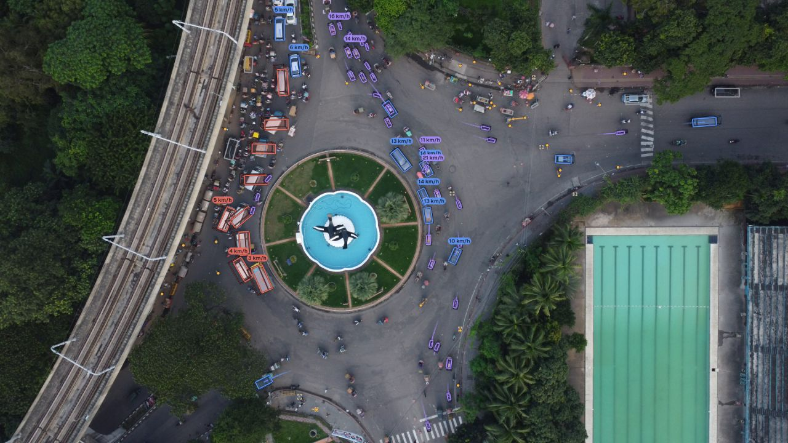

# Drone footage (straight-down views)

The sample `dhaka-roundabout` is 30 s of dense mixed traffic at a roundabout, recorded by a DJI drone that hovers 111.7 m above its take-off point and looks straight down. The video is 3840 x 2160 at 23.976 fps, from [DRINF](https://huggingface.co/datasets/hamimmahmud0/DRINF) by Hamim Mahmud, CC BY 4.0. Straight-down (nadir) views are processed with a known camera instead of automatic calibration. This page derives that camera from the flight log and the lens's field of view, runs the pipeline, explains why automatic calibration is not used here, and checks the result against the scene.

<figure markdown="span">
  
  <figcaption>`dhaka-roundabout` with Tachymetry's output. Known camera: pitch 90°, height 111.7 m, f = 2825.2 px.</figcaption>
</figure>

## One command

```bash
tachymetry demo --sample dhaka-roundabout -o runs/dhaka
```

The demo downloads the 30 s excerpt (about 390 MB), prints its attribution and the camera, and uses the sample's known camera (`tachymetry.data.sample_camera`) with `detector.imgsz = 2560` (`tachymetry.data.sample_overrides`). On one NVIDIA RTX PRO 6000, with the detections already cached, it took 60 s, most of it rendering the 4K video. The sections below make each of these choices explicit.

## The camera

A straight-down pinhole camera over flat ground is fixed by three quantities:

- **Pitch** 90°, roll 0°. The yaw only orients the world frame. The default `yaw=90` puts world $+y$ along the image's up direction.
- **Height** $h$ above the road: the drone's relative altitude, read from its flight log (below).
- **Focal length** from the horizontal field of view: $f = (w/2) / \tan(\mathrm{HFOV}/2)$. The DJI Mini 2 records 4K video with a 68.4° horizontal field of view. `DZOOM 1.000` in the flight log confirms that no digital zoom was applied, so $f = 1920 / \tan 34.2° = 2825.2$ px.

For this geometry the ground sampling distance is $h / f$ = 3.95 cm per pixel. It is the same everywhere in the image, because a nadir pinhole camera images the ground plane with a uniform scale. `Camera.ground_sampling_distance` returns 0.03954 m at the centre and at both corners.

### Altitude from the DJI subtitle track

DJI drones record per-second telemetry as a subtitle stream, inside the MP4 or as a sidecar `.SRT` file. The DRINF recording carries it as a `mov_text` stream. Extract it with the FFmpeg binary that `imageio-ffmpeg` installs; `-ss` and `-t` select the excerpt window:

```bash
FFMPEG=$(python -c "import imageio_ffmpeg; print(imageio_ffmpeg.get_ffmpeg_exe())")
"$FFMPEG" -v error -ss 140 -i DJI_0403_merged.mp4 -t 30 -map 0:s:0 flight.srt
```

Each entry looks like this:

```text
F/2.8, SS 100.00, ISO 400, EV -0.3, DZOOM 1.000, GPS (...), D 45.70m, H 111.70m, H.S 0.00m/s, V.S -0.00m/s
```

| Field | Meaning |
|---|---|
| `H` | altitude above the take-off point |
| `D` | horizontal distance from the take-off point |
| `H.S` | horizontal speed |
| `V.S` | vertical speed |
| `DZOOM` | digital zoom factor |

The following function collects `H` over a time window:

```python
import re
import statistics


def srt_altitudes(path, start_s=0.0, end_s=float("inf")):
    """DJI relative altitude ("H", metres above the take-off point) of each subtitle entry in [start_s, end_s)."""
    text = open(path, encoding="utf-8").read()
    out = []
    for block in re.split(r"\n\s*\n", text.strip()):
        t = re.search(r"(\d+):(\d+):(\d+)[,.](\d+)\s*-->", block)
        h = re.search(r"\bH (-?\d+(?:\.\d+)?)m\b", block)
        if t and h:
            hh, mm, ss, ms = map(int, t.groups())
            s = 3600 * hh + 60 * mm + ss + ms / 1000
            if start_s <= s < end_s:
                out.append(float(h.group(1)))
    return out


alt = srt_altitudes("flight.srt")
print(len(alt), min(alt), statistics.median(alt), max(alt))
```

```text
32 111.4 111.55 111.8
```

The altitude varies between 111.4 and 111.8 m during the excerpt. The sample camera uses 111.7 m, the first reading. Distances and speeds scale with $h$, so the 0.3 m range corresponds to 0.3 %.

`H` is the barometric height above the take-off point. If the drone took off from a level other than the road, add the difference.

## Python

```python
import math

import tachymetry as tm
from tachymetry.data import attribution, sample_video

video = sample_video("dhaka-roundabout")       # 30 s excerpt, 3840 x 2160 at 23.976 fps, about 390 MB
print(attribution("dhaka-roundabout"))

w, h = 3840, 2160
hfov = 68.4                                    # DJI Mini 2, 4K video, no digital zoom (DZOOM 1.000)
focal = (w / 2) / math.tan(math.radians(hfov / 2))
cam = tm.Camera.from_pose((w, h), focal=focal, height=111.7, pitch=90.0)
print(cam.describe())
print(f"ground sampling distance {100 * cam.height / cam.focal:.2f} cm/px")
cam.save("cam.json")

run = tm.track(video, out="runs/dhaka", camera=cam, detector__imgsz=2560)
print(run.summary()["by_class"])
```

```text
DRINF: Dhaka Road Intersection Nadir Footage by Hamim Mahmud (Hugging Face, doi:10.57967/hf/10301); 30 s excerpt from 2:20, CC BY 4.0, https://huggingface.co/datasets/hamimmahmud0/DRINF
f=2825.2px (hfov 68.4 deg), height=111.70 m, pitch=90.00 deg, roll=0.00 deg, yaw=90.0 deg, lens=identity
ground sampling distance 3.95 cm/px
{'bicycle': 72, 'person': 85, 'motorcycle': 79, 'car': 39, 'truck': 11}
```

Detection, tracking and export took 43 s on one GPU. The class counts are the detector's labels for accepted tracks.

**Detector input size.** `detector.imgsz = 2560` keeps small road users resolvable. At 3.95 cm/px a pedestrian, about 0.5 m across, covers 13 px of the 4K frame. The default input size of 960 shrinks the frame by 4, leaving 3 px; 2560 leaves 8 px.

## Command line

```bash
python -c "import math, tachymetry as tm; tm.Camera.from_pose((3840, 2160), focal=1920 / math.tan(math.radians(34.2)), height=111.7, pitch=90.0).save('cam.json')"
tachymetry run ~/.cache/tachymetry/samples/dhaka-roundabout.mp4 --camera cam.json --imgsz 2560 --out runs --render
```

The sample is stored under `$TACHYMETRY_CACHE/samples`, by default `~/.cache/tachymetry/samples`, once `sample_video("dhaka-roundabout")` or the demo has fetched it. A camera given with `--camera` is used as is; it is resized if the video's resolution differs. For a flight with a different altitude or lens, change `height` and the field of view.

## Why automatic calibration is not used

Automatic calibration ([Automatic calibration](../guide/auto-calibration.md)) assumes an oblique view, in which perspective changes the image shape of ground rectangles with position. In a straight-down view that signal is absent, and two biases take its place. The script below reproduces both from the run above:

```python
import warnings

import cv2
import numpy as np

import tachymetry as tm
from tachymetry.calib import calibrate_auto
from tachymetry.calib.from_cuboids import collect_footprints, footprint_scale
from tachymetry.detections import DetectionSet

dets = DetectionSet.load("runs/dhaka/detections.npz")
background = cv2.imread("runs/dhaka/background.jpg")

# 1. what automatic calibration makes of a straight-down view
with warnings.catch_warnings():
    warnings.simplefilter("ignore")
    res = calibrate_auto(background, dets)
print(res.method, res.camera.describe())

# 2. footprint shape in the image: a straight-down camera images the ground at one scale,
#    so the length-to-width ratio of car footprints must not depend on their orientation
quads, weights = collect_footprints(dets)
L = np.linalg.norm(quads[:, 0] - quads[:, 1], axis=1) + np.linalg.norm(quads[:, 3] - quads[:, 2], axis=1)
W = np.linalg.norm(quads[:, 0] - quads[:, 3], axis=1) + np.linalg.norm(quads[:, 1] - quads[:, 2], axis=1)
axis = (quads[:, 0] + quads[:, 3]) - (quads[:, 1] + quads[:, 2])
angle = np.degrees(np.arctan2(np.abs(axis[:, 1]), np.abs(axis[:, 0])))  # 0 = image horizontal
print(f"aspect, axis near horizontal: {np.median((L / W)[angle < 30]):.2f}; near vertical: {np.median((L / W)[angle > 60]):.2f}")

# 3. vehicle-size scale under the known camera (1.0 would mean the car prior fits)
cam = tm.Camera.load("cam.json")
scale, info = footprint_scale(cam, quads, weights)
print(f"vehicle-size scale factor under the known camera: {scale:.2f}")
```

```text
auto:fused f=21038.5px (hfov 10.4 deg), height=1342.95 m, pitch=66.12 deg, roll=0.20 deg, yaw=0.5 deg, lens=identity
aspect, axis near horizontal: 2.75; near vertical: 2.24
vehicle-size scale factor under the known camera: 1.83
```

1. **Footprint bias.** A nadir camera images the ground at a uniform scale, so the image aspect ratio of a car footprint should not depend on its orientation. The detector's footprints are compressed along the image vertical: the median length-to-width ratio is 2.75 for car footprints whose long axis lies within 30° of the image horizontal and 2.24 within 30° of the vertical (2500 trusted footprints).
2. **A false tilt.** The cuboid solver explains this compression as perspective. The fused estimate places the camera at a pitch of 66°, a focal length of 21,000 px (HFOV 10.4°) and a height of 1343 m.
    - The scene contradicts it. The roundabout's central island images as a circle: an ellipse fitted to its outline has an axis ratio of 0.98, whereas a circle seen at 66° below the horizon would image with an axis ratio of about $\sin 66° = 0.91$.
    - `Pipeline` flags such results. When automatic calibration places the camera more than `MAX_PLAUSIBLE_HEIGHT_M` = 250 m above the ground, it issues a warning and stores the note in `camera.meta["warnings"]` ([Camera calibration](../guide/calibration.md#implausible-automatic-calibrations)).
3. **Vehicle-size scale.** UrbanOmniDetect-2 labels the CNG auto-rickshaws of this traffic, about 2.6 m long, as `car`.
    - Back-projected with the known camera, car-class footprints have a median size of 2.3 m by 1.0 m, against the 4.6 m by 1.85 m prior. This reflects both the rickshaws and the footprint bias.
    - The vehicle-size cue would therefore multiply all distances and speeds by 1.83.
    - Scenes whose `car` class is dominated by smaller vehicles need a scale from elsewhere: `scale="height=..."`, `scale="lane_width=..."` or a known camera ([Limitations](../limitations.md#mixed-traffic-and-class-dependent-scale)).

## Checks of the known camera

The known camera is not compared with ground truth: the clip has none. The quantities below are independent of the calibration inputs and should be read as consistency checks.

| Check | Measured | Reference |
|---|---|---|
| Width of the swimming pool beside the roundabout, in the bird's-eye view | 24.3 m | 25 m if it is a standard 50 m pool; its far end lies outside the frame |
| Roundabout island in the image | circle, axis ratio 0.98; diameter 29.7 m | a circular island under a nadir view |
| Pedestrians, median of per-track median speeds (60 moving tracks) | 4.5 km/h | free walking speeds of 1.2 to 1.4 m/s (4.3 to 5.0 km/h) |
| Cars, median of per-track median speeds (33 moving tracks) | 12.1 km/h | congested roundabout |
| Motorcycles, median of per-track median speeds (69 moving tracks) | 13.2 km/h | congested roundabout |

The speeds are computed from `tracks_summary.csv` of the run above:

```python
import pandas as pd

s = pd.read_csv("runs/dhaka/tracks_summary.csv")
moving = s[(s.verdict == "ok") & (s.state == "moving")]
print(moving.groupby("class").speed_median_kmh.median().round(1))
```

```text
class
bicycle       13.4
car           12.1
motorcycle    13.2
person         4.5
truck          5.3
Name: speed_median_kmh, dtype: float64
```

## Rendering straight-down views

A nadir camera has no horizon in the image: `Camera.below_horizon` accepts all finite pixels. The bird's-eye view is oriented by `Camera.ground_up()`, the ground direction that appears as up in the image. It sums the ground projections of the optical axis and of the image's up axis. The first projection vanishes for a nadir camera and the second for a level one, so the orientation is defined for all pitches in between. Detections without a metric track are drawn as corner brackets ([Rendering](../guide/rendering.md#what-is-drawn)).
