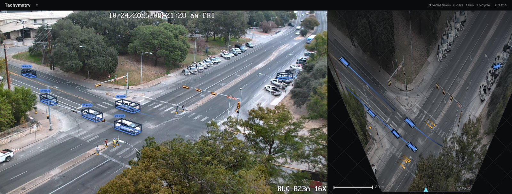

# End-to-end: a signalised intersection

This example runs the full pipeline on the public sample clip `intersection-day`, an elevated camera over a signalised intersection (1920×1080, 30 fps, 31 s), from the Hugging Face dataset [svbrd-llm-roadside-video-av](https://huggingface.co/datasets/Ryan-xiangyu-ut/svbrd-llm-roadside-video-av) (CC BY 4.0). The clip is downloaded once into the Hugging Face cache by `tachymetry.data.sample_video`. All outputs below were produced by the commands shown, on one NVIDIA RTX PRO 6000 Blackwell Max-Q GPU.

## Command line

```bash
tachymetry demo --out demo_run
```

`tachymetry demo` downloads the clip, runs detection, automatic calibration, tracking, export and rendering, and writes everything to `demo_run/`. `--device cuda:1` selects a GPU, `--sample` another clip (`intersection-day-2`, `intersection-day-3`, `intersection-turn`, `intersection-night`).

## Python

```python
import tachymetry as tm
from tachymetry.data import SAMPLE_ATTRIBUTION, sample_video

clip = sample_video("intersection-day")  # downloaded once into the Hugging Face cache
print(SAMPLE_ATTRIBUTION)

run = tm.track(clip, out="runs/intersection-day", render=True)
print(run.camera.describe())
print(run.camera.meta["calibration_method"])
print(run.summary())
print(run.report["timings"])
```

```text
Sample footage: svbrd-llm-roadside-video-av (Ryan-xiangyu-ut, Hugging Face), licensed CC BY 4.0.
f=2163.0px (hfov 47.9 deg), height=28.40 m, pitch=18.22 deg, roll=-0.16 deg, yaw=133.7 deg, lens=identity
auto:fused
{'tracks': 44, 'by_class': {'person': 9, 'bus': 2, 'car': 31, 'bicycle': 2}, 'moving_by_class': {'person': 8, 'bus': 2, 'car': 20, 'bicycle': 2}, 'parked_by_class': {'car': 11}, 'rejected': {'rider': 2, 'ghost': 1, 'duplicate': 2}, 'vehicle_speed_kmh': {'median': 24.72, 'p85': 35.24, 'max': 55.82}}
{'detect_s': 6.95, 'calibrate_s': 13.6, 'track_s': 3.43, 'render_s': 28.73, 'total_s': 52.84}
```

The automatic calibration selected the fused candidate (learned cuboid footprints plus road-marking and vertical vanishing points, [Automatic calibration](../guide/auto-calibration.md)): a camera 28.4 m above the road, pitched 18.2° down, with a 47.9° horizontal field of view. The metric scale comes from the median passenger-car footprint. The run directory now holds the files described in [Outputs](../guide/outputs.md):

```text
runs/intersection-day/
  background.jpg  calibration_preview.jpg  camera.json  camera.report.json  config.yaml
  detections.json  detections.npz  overlay.mp4  summary.json  tracks.csv  tracks.json  tracks_summary.csv
```



!!! note "Reproducibility of the calibration"
    In four runs of this clip on the same machine (this script, `tachymetry demo`, and two batch runs), detections and background were identical, but the fused least-squares fit converged to one of two nearby solutions: $f$ = 2163 px, pitch 18.22°, height 28.40 m (44 `ok` tracks, median vehicle speed 24.72 km/h), or $f$ = 2232 px, pitch 17.84°, height 28.38 m (43 tracks, 24.55 km/h). Check `calibration_preview.jpg`, and pass a fixed camera (`camera="runs/intersection-day/camera.json"`) when several runs must share one calibration.

## Analysing the outputs

`tracks.csv` holds one row per track and processed frame and `tracks_summary.csv` one row per track, including rejected tracks. The script below reads both with pandas and computes counts, the rejected tracks, spot-speed percentiles of moving motor vehicles, and a directional count at a screen line.

```python
import numpy as np
import pandas as pd

samples = pd.read_csv("runs/intersection-day/tracks.csv")  # one row per track and processed frame
tracks = pd.read_csv("runs/intersection-day/tracks_summary.csv")  # one row per track, rejected ones included

# Road users by class and state (accepted tracks only)
ok = tracks[tracks.verdict == "ok"]
print(pd.crosstab(ok["class"], ok["state"]))

# Rejected tracks and the rule that rejected them
print(tracks.loc[tracks.verdict != "ok", ["id", "class", "verdict", "reason"]].to_string(index=False))

# Spot speeds of moving motor vehicles (samples above 3 km/h)
veh = samples[samples["class"].isin(["car", "bus", "truck"]) & (samples.state == "moving")]
spot = veh.loc[veh.speed_kmh > 3, "speed_kmh"]
print(spot.describe(percentiles=[0.15, 0.5, 0.85]).round(1).to_string())

# A screen line across the main road: x = 0 m, restricted to y < -25 m
counts = {"+x": 0, "-x": 0}
for tid, g in veh.groupby("track_id"):
    g = g[g.y_m < -25]
    x = g.x_m.to_numpy()
    if len(x) > 1 and x.min() < 0 < x.max():
        counts["+x" if x[-1] > x[0] else "-x"] += 1
print(counts)
```

```text
state    moving  parked  stationary
class
bicycle       2       0           0
bus           2       0           0
car          20      11           0
person        8       0           1
 id  class   verdict                    reason
 28 person     rider     riding two-wheeler 23
 31    car     ghost low confidence and static
 33    car duplicate           duplicate of 10
 38 person     rider     riding two-wheeler 35
 48    car duplicate           duplicate of 31
count    2167.0
mean       25.6
std         9.6
min         3.0
15%        15.5
50%        25.1
85%        35.6
max        55.8
{'+x': 9, '-x': 2}
```

Notes on the result:

* The two riders are the persons on the two bicycles; they are counted once, as cyclists ([Verdicts](../guide/verdicts.md#riders-and-inferred-cyclists)).
* Eleven parked cars are reported with zero speed; they do not enter the speed statistics.
* The world frame of an automatic calibration has $+x$ along the best-supported lane-line direction and its origin at the median vehicle position, so the main road runs along $x$ at $y \approx -35$ to $-45$ m in this clip. For counts at a specific location, define the screen line in this frame, or calibrate manually against a georeferenced reference to work in map coordinates ([Manual calibration](../guide/manual-calibration.md)).
* The spot speeds are samples at 15 Hz, so longer tracks weigh more. For one value per vehicle use `tracks_summary.csv` (`speed_median_kmh`, `speed_p85_kmh`).

## Changing settings without re-detecting

Detections and the automatic calibration are cached in the run directory ([Pipeline](../guide/pipeline.md#caching-and-re-runs)). Re-running with other tracking settings takes seconds:

```python
import tachymetry as tm
from tachymetry.data import sample_video

pipe = tm.Pipeline()
pipe.config.hygiene.smooth_window_s = 0.8
pipe.config.exports = ("csv", "json", "geojson")
run = pipe.run(sample_video("intersection-day"), "runs/intersection-day")
print(run.report["timings"], run.summary()["vehicle_speed_kmh"])
```

```text
{'detect_s': 0.02, 'calibrate_s': 0.01, 'track_s': 3.41, 'total_s': 3.58} {'median': 24.85, 'p85': 35.39, 'max': 54.17}
```

A shorter smoothing window follows speed changes faster at the cost of more noise ([Bird's-eye view and speed](../guide/bev-speed.md#speed)); on this clip the median and 85th-percentile vehicle speeds move by less than 0.2 km/h.
