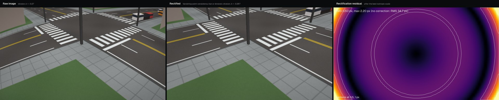
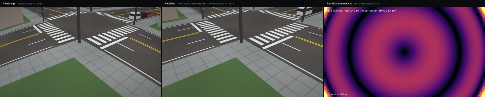
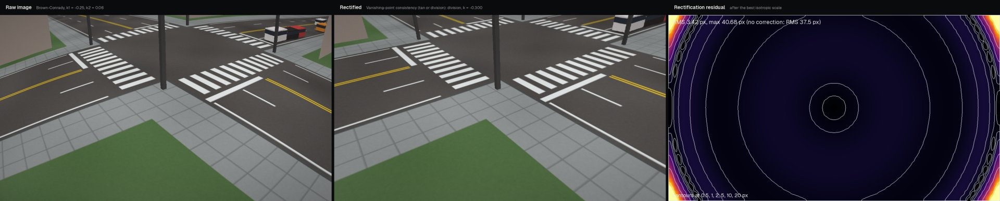
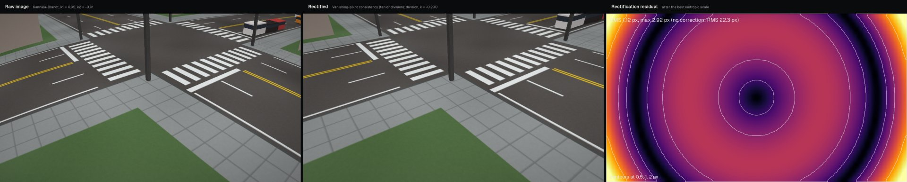

# Lens rectification

This example renders the same synthetic intersection through four lens models with known parameters, estimates the distortion with the estimators of [Lens models](../guide/lens-models.md), and measures how far each estimated rectification is from the true one.

## Protocol

- **Camera.** `default_camera((1280, 720), lens=...)`: 8 m high, pitch 32 degrees, horizontal field of view 70 degrees ($f$ = 914 px) for the rectified image.
- **True lenses.** `DivisionLens(size, k=-0.27)`; `EquidistantLens(size, s=900.0)`; `BrownConradyLens(size, k1=-0.25, k2=0.06)` (radial unit: half the image diagonal, 734.3 px); `FisheyeLens(size, k1=0.05, k2=-0.01, focal=914.0)`.
- **Scene.** `make_scene(camera, RoadLayout(), seed=0)`: the raw (distorted) image of a marked four-way intersection with poles and buildings.
- **Estimators.** Plumb-line with the division model and with the equidistant model (`estimate_lens_plumbline`); vanishing-point consistency with the division model on the LSD segments of the raw image (`estimate_lens_vp_consistency`), as used by `calibrate_from_lines(lens="auto")`; and manual calibration (`calibrate_manual`, `lens="auto"`) from 16 ground correspondences with 0.5 px Gaussian noise.
- **Residual.** For each raw pixel on a 16 px grid, the estimated and the true rectifications are compared after the best isotropic scale about the image centre (a pure scale change of the rectified image is absorbed by the focal length of the camera and does not affect ground measurements). The table reports the RMS and the maximum displacement in pixels; the *identity* row is the error of leaving the lens uncorrected.

The table is produced by `tools/make_docs_media.py`.

--8<-- "docs/media/lens_rectification.md"

## Figures

Each figure shows the raw image (left), the image rectified with the best estimate (centre) and the residual map of that estimate in pixels (right).

<figure markdown="span">
  
  <figcaption>True division lens, $k = -0.27$.</figcaption>
</figure>

<figure markdown="span">
  
  <figcaption>True equidistant lens, $s = 900$ px.</figcaption>
</figure>

<figure markdown="span">
  
  <figcaption>True Brown–Conrady lens, $k_1 = -0.25$, $k_2 = 0.06$; the one-parameter estimates approximate a two-parameter model.</figcaption>
</figure>

<figure markdown="span">
  
  <figcaption>True Kannala–Brandt lens, $k_1 = 0.05$, $k_2 = -0.01$, $F = 914$ px.</figcaption>
</figure>

## Recovering the equidistant (`tan`) parameter

The equidistant-to-pinhole model, $r_u = s \tan(r_d / s)$, is the [recommended model](../guide/lens-models.md#recommended-model-equidistant-to-pinhole-tan) for wide-angle surveillance lenses. The script renders the scene through `EquidistantLens(size, s=900.0)` and estimates $s$ with vanishing-point consistency, with road-marking calibration (`lens="tan"`) and with manual calibration from 16 ground points (0.5 px noise, `lens="equidistant"`).

```python
import numpy as np
from tachymetry.calib import Correspondences, calibrate_from_lines, calibrate_manual, estimate_lens_vp_consistency
from tachymetry.calib.lines import detect_segments
from tachymetry.geometry import EquidistantLens
from tachymetry.synthetic import RoadLayout, default_camera, make_scene

size = (1280, 720)
true = EquidistantLens(size, s=900.0)                     # the lens to recover
camera = default_camera(size, lens=true)                  # 8 m high, 32 deg down, 70 deg HFOV
image = make_scene(camera, RoadLayout(), seed=0).image    # raw image seen through the lens

# 1. vanishing-point consistency on the LSD segments of the raw image
vp, info = estimate_lens_vp_consistency(detect_segments(image), size, model="equidistant")
# 2. road-marking calibration with the tan model
lines = calibrate_from_lines(image, scale="height=8", lens="tan")
# 3. manual calibration from 16 ground points with 0.5 px click noise
rng = np.random.default_rng(0)
uv = rng.uniform([0, 0], [1279, 719], size=(6000, 2))
uv = uv[camera.ground_sampling_distance(uv) <= 0.30][:16]
corr = Correspondences(uv + rng.normal(0, 0.5, uv.shape), camera.image_to_ground(uv), image_size=size)
manual = calibrate_manual(corr, lens="equidistant")

for name, lens in (("VP consistency", vp), ("lines, lens='tan'", lines.camera.lens), ("manual", manual.camera.lens)):
    s = getattr(lens, "s", float("inf"))
    print(f"{name:18s} {lens.kind:12s} s = {s:6.1f} px   error {100 * (s / true.s - 1):+5.2f} %")
```

Output (Linux, NumPy 2.4, OpenCV 4.13; about 8 s on a CPU):

```text
VP consistency     equidistant  s =  893.1 px   error -0.77 %
lines, lens='tan'  equidistant  s =  893.1 px   error -0.77 %
manual             equidistant  s =  897.2 px   error -0.31 %
```

The vanishing-point estimate lies on the estimator's grid, whose step in $1/s$ corresponds to 2.7 % of $s$ at $s$ = 900 px; the manual estimate is continuous and limited by the click noise.

## Reproducing one case

The script below estimates a division lens from the line segments of one raw image and evaluates the residual with the protocol above. It uses $k = -0.27$, as the protocol does, which is not a node of the estimator's search grid (the coarse grid of `estimate_lens_vp_consistency` contains $k = -0.30$; a true value on a node would be recovered without quantisation error, which would overstate the accuracy).

```python
import numpy as np
from tachymetry.calib import estimate_lens_vp_consistency
from tachymetry.calib.lines import detect_segments
from tachymetry.geometry import DivisionLens
from tachymetry.synthetic import RoadLayout, default_camera, make_scene

size = (1280, 720)
true = DivisionLens(size, k=-0.27)
scene = make_scene(default_camera(size, lens=true), RoadLayout(), seed=0)   # raw, distorted image

segments = detect_segments(scene.image)                                     # LSD on the raw image
est, info = estimate_lens_vp_consistency(segments, size, model="division")
print(f"k = {est.k:.3f} (true {true.k:.3f}); VP support {info['support_identity']:.2f} -> "
      f"{info['support']:.2f} of the segment length")

# rectification error on a 16 px grid of raw pixels, after the best isotropic scale about the centre
uu, vv = np.meshgrid(np.arange(0, size[0], 16.0), np.arange(0, size[1], 16.0))
raw = np.column_stack([uu.ravel(), vv.ravel()])
c = np.asarray(true.center)
for name, lens in (("uncorrected", None), ("estimated", est)):
    a = (raw if lens is None else lens.rectify(raw)) - c
    b = true.rectify(raw) - c
    s = np.sum(a * b) / np.sum(a * a)
    d = np.linalg.norm(s * a - b, axis=1)
    print(f"{name:12s} RMS {np.sqrt(np.mean(d**2)):6.2f} px   max {d.max():6.2f} px")
```

Output (Linux, NumPy 2.4, OpenCV 4.13; about 4 s on a CPU):

```text
k = -0.267 (true -0.270); VP support 0.49 -> 0.97 of the segment length
uncorrected  RMS  34.78 px   max 151.14 px
estimated    RMS   0.50 px   max   2.40 px
```

With the true distortion removed, 97 % of the segment length supports three vanishing points, against 49 % in the raw image. The remaining error comes from the grid quantisation of the estimator (step $1/60$ in $k$).

## Observations

- **Vanishing-point consistency** uses the agreement of segment directions with common vanishing points and needs only short segments; on this scene it recovered the division lens and the equidistant lens to the grid resolution. `calibrate_from_lines(lens="auto")` runs it for both the `tan` and the division model and keeps the one with the higher support, provided it beats the pinhole by a gain above 0.08 and a support ratio above 1.2.
- **Plumb lines** need long straight edges away from the distortion centre. In this scene most extracted edge chains are short or pass near the centre, and the trimmed straightness objective is already small without correction (0.28 px for the division case, 43 chains), so the plumb-line estimate is weakly constrained (for the true division lens it returned $k = -0.068$ instead of $-0.27$).
- **Model mismatch.** One-parameter models approximate the Brown–Conrady and Kannala–Brandt lenses only to first order; the residual maps show where the approximation breaks down, typically in the image corners. Manual calibration can fit `brown` or `fisheye` directly when correspondences cover the corners (`calibrate_manual(corr, lens="brown")`).
- **Correspondences** constrain the lens through the reprojection of known ground points, and cross-validation selects the model; for the equidistant lens a division model can be selected when it predicts held-out points equally well.
