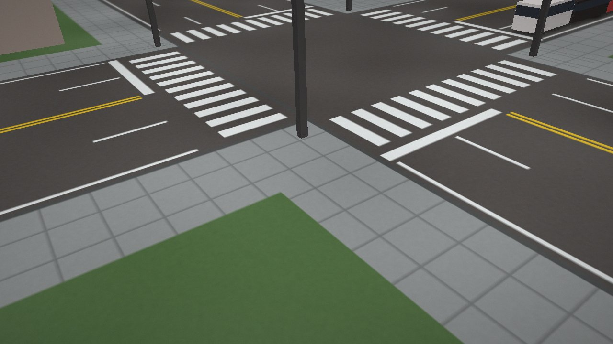
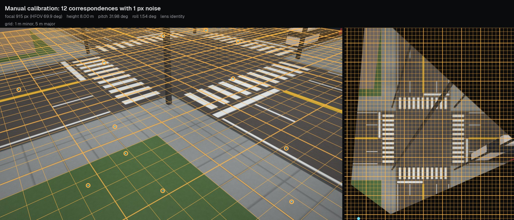
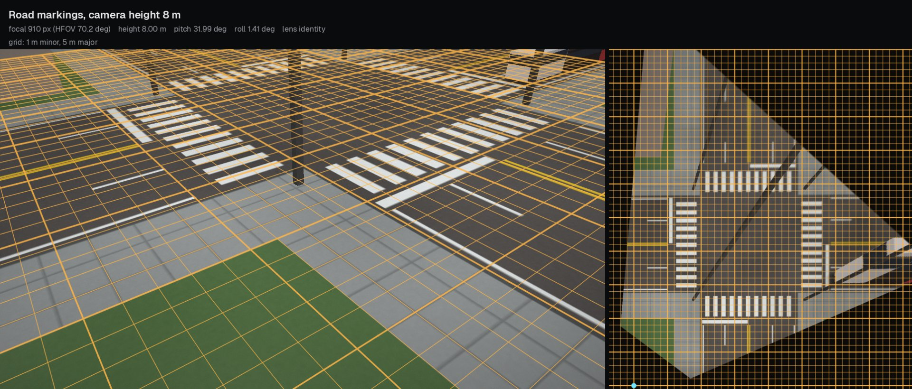
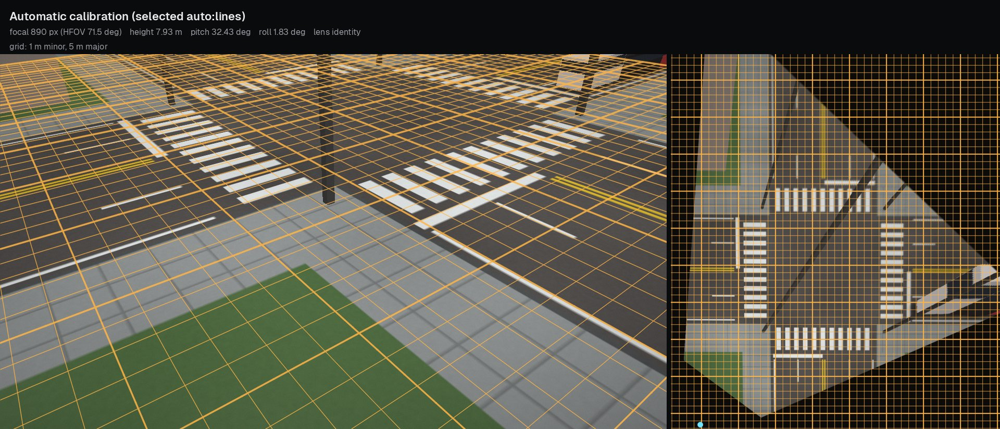

# Synthetic calibration walkthrough

This example calibrates a rendered intersection whose camera is known, with each calibration method, and compares the estimates with the ground truth. Everything runs on a CPU in about ten seconds and needs no downloads.

## Scene and evidence

`tachymetry.synthetic` renders a metric ground texture (asphalt, lane lines, zebra crosswalks, stop lines, kerbs, sidewalk joints) through a known camera with per-pixel mip-mapping, and adds shaded boxes for vehicles, signal poles and buildings (`synthetic/scene.py`). `synthetic.traffic.simulate` produces the detections a cuboid detector would report for simulated traffic seen by the same camera, with box jitter, corner noise, missed detections, label flicker and false positives (`synthetic/traffic.py`).

The ground-truth camera is `default_camera((1280, 720))`: 8 m above the ground, pitch 32 degrees, roll 1.5 degrees, yaw 55 degrees, horizontal field of view 70 degrees ($f$ = 914.0 px), no lens distortion.

<figure markdown="span">
  
  <figcaption>`make_scene(default_camera((1280, 720)), RoadLayout(), seed=0)`: a four-way intersection with two lanes per direction, crosswalks, stop lines, queued and parked vehicles, poles and buildings.</figcaption>
</figure>

## Calibrating with each method

```python
import numpy as np
from tachymetry.calib import Correspondences, calibrate_auto, calibrate_from_cuboids, calibrate_from_lines, calibrate_manual
from tachymetry.synthetic import RoadLayout, default_camera, make_scene
from tachymetry.synthetic.traffic import TrafficSpec, simulate

truth = default_camera((1280, 720))                           # the camera to recover
scene = make_scene(truth, RoadLayout(), seed=0)               # traffic-free image of a marked intersection
dets, agents = simulate(truth, TrafficSpec(duration_s=60, seed=0))   # 60 s of detections with cuboids

rng = np.random.default_rng(0)                                # 12 surveyed points, 1 px click noise
uv = rng.uniform([0, 0], [1279, 719], size=(4000, 2))
uv = uv[truth.ground_sampling_distance(uv) <= 0.30][:12]
corr = Correspondences(uv + rng.normal(0, 1.0, uv.shape), truth.image_to_ground(uv), image_size=(1280, 720))

results = {
    "manual": calibrate_manual(corr),
    "lines": calibrate_from_lines(scene.image, scale="height=8"),
    "cuboids": calibrate_from_cuboids(dets),
    "auto": calibrate_auto(scene.image, dets),
}
for name, res in results.items():
    cam = res.camera
    print(f"{name:8s} [{res.method:12s}] focal {100 * (cam.focal / truth.focal - 1):+6.2f} %   "
          f"pitch {cam.pitch - truth.pitch:+6.2f} deg   roll {cam.roll - truth.roll:+6.2f} deg   "
          f"height {cam.height:6.2f} m")
```

Output (Linux, NumPy 2.4, OpenCV 4.13):

```text
manual   [manual      ] focal  -0.04 %   pitch  +0.03 deg   roll  -0.05 deg   height   7.99 m
lines    [lines       ] focal  -2.67 %   pitch  +0.43 deg   roll  +0.33 deg   height   8.00 m
cuboids  [cuboids     ] focal  -4.96 %   pitch  +0.69 deg   roll  +0.32 deg   height   7.71 m
auto     [auto:lines  ] focal  -2.67 %   pitch  +0.43 deg   roll  +0.33 deg   height   7.93 m
```

How each estimate is obtained:

- **manual** fits the physical camera to 12 correspondences, chooses the lens model by 10-fold cross-validation, and inherits its metric scale from the world coordinates ([Manual calibration](../guide/manual-calibration.md)).
- **lines** recovers focal length, pitch and roll from the vanishing points of the painted markings and the vertical structures; its height is the scale cue (`scale="height=8"`), so its height error is zero by construction and its accuracy is visible in the focal length and angles.
- **cuboids** uses the 351 trusted car footprints of the simulated traffic and the 4.6 m by 1.85 m car prior for scale. Simulated moving cars are drawn with lengths $\mathcal{N}(4.6, 0.35^2)$ m and widths $\mathcal{N}(1.85, 0.08^2)$ m and parked cars measure 4.5 m by 1.85 m, close to the prior; the height (7.71 m, −3.6 %) is the scale implied by the footprint sizes measured with the estimated camera.
- **auto** evaluates `lines`, `cuboids` and `fused` on the same evidence. Here the `lines` candidate scored highest (0.348, against 0.279 for `cuboids` and 0.270 for `fused`; see [Ranking](../guide/auto-calibration.md#ranking)), and the vehicle-size scale gave a height of 7.93 m.

The automatic methods agree with each other to within 2.3 % in focal length and 0.3 degrees in pitch, and all underestimate the focal length, by 2.7 to 5.0 %. The table below measures the consequence of these errors on the ground plane directly.

## Measured errors

The table is produced by `tools/make_docs_media.py` on the same scene and traffic.

--8<-- "docs/media/synthetic_calibration.md"

**Protocol.** Errors are relative to the ground-truth camera. *Focal error* is $f / f_\mathrm{true} - 1$; *pitch*, *roll* and *height* errors are differences. The ground comparison uses a grid of image points whose true ground sampling distance is at most 0.30 m per pixel (the region in which the tracker measures, `hygiene.max_gsd_m`); each point is back-projected with the true camera and with the estimate. For methods whose world frame is arbitrary (yaw and origin chosen by the calibration), the estimated ground points are aligned to the true ones by the least-squares 2D rigid transform (rotation and translation, no scale), and *ground RMS after rigid alignment* is the remaining RMS distance in metres; it contains the scale error. *Scale error* is the scale factor of a separate least-squares similarity fit, minus one, i.e. the bias that every distance and speed would inherit. For manual calibration, the input is 12 ground points sampled with a fixed seed from the same region, projected through the true camera with 1.0 px Gaussian noise, and calibrated with `lens="auto"`.

## Previews

<figure markdown="span">
  
  <figcaption>Manual calibration from 12 noisy correspondences.</figcaption>
</figure>

<figure markdown="span">
  
  <figcaption>Calibration from road markings and vertical structures, scaled with the known height of 8 m.</figcaption>
</figure>

<figure markdown="span">
  
  <figcaption>Automatic calibration (`calibrate_auto`) from the background image and 60 s of simulated detections.</figcaption>
</figure>

## Variations

- `default_camera(size, height=..., pitch=..., hfov=..., position=..., yaw=...)` changes the viewpoint; `RoadLayout(kind="straight", lanes_ew=3, rotation_deg=20)` changes the road.
- `default_camera(size, lens=DivisionLens(size, k=-0.2))` renders through a distorted lens; `calibrate_from_lines(..., lens="auto")` then estimates the distortion (see [Lens rectification](lens-rectification.md)).
- `TrafficSpec(vehicles_per_min=..., parked=..., miss_prob=..., corner_noise=...)` controls the amount and quality of the cuboid evidence.
