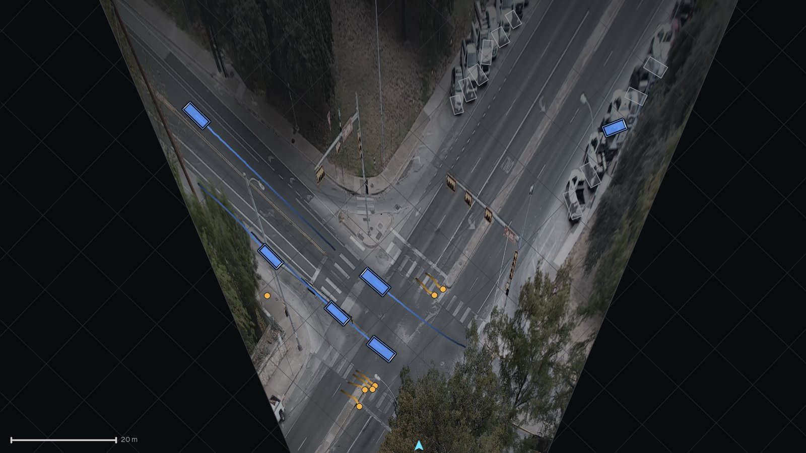

# Bird's-eye view and speed estimation

Positions and speeds are measured on a ground plane in metres. This page describes the projection from pixels to the plane, how its precision varies across the image, why the box bottom is a biased position, and how speeds are derived. Camera conventions are those of `geometry/camera.py`.

## Projection to the ground plane

A calibrated `Camera` holds intrinsics $K$, rotation $R$, translation $t$ (world to camera, $X_c = R X_w + t$), a lens model and the image size. The world frame is right-handed with $z$ up and the road at $z = 0$; with automatic calibration $x$ points along the main road and the origin is the median vehicle position, with manual calibration the frame is that of the correspondences ([Calibration](calibration.md)).

`Camera.image_to_ground` maps a raw pixel $u$ by removing lens distortion, $\tilde u = \text{lens.rectify}(u)$, forming the viewing ray $d = R^\top K^{-1} (\tilde u, 1)^\top$ from the camera centre $C = -R^\top t$, and intersecting it with the plane:

$$
X = C + s\,d,\qquad s = \frac{z - C_z}{d_z},
$$

returning NaN for $s \le 0$ (pixels on or above the horizon). Lens distortion enters only through `rectify`; for wide surveillance lenses the recommended model is the one-parameter equidistant model $r_u = s\tan(r_d / s)$ (`EquidistantLens`, `--lens tan` on the command line), see [Lens models](lens-models.md). On the plane $z = 0$ this is the homography $H = K\,[r_1\; r_2\; t]$ from ground to rectified pixels and its inverse; `camera.json` stores $H^{-1}$ as `H_image_to_ground`, which applies to rectified pixels.

## Ground sampling distance

The ground sampling distance (GSD) at a pixel is the ground length covered by one pixel. `Camera.ground_sampling_distance` evaluates the Jacobian $J = \partial(x, y)/\partial(u, v)$ of `image_to_ground` by one-pixel differences and returns, by default (`mode="max"`), its largest singular value

$$
\sigma_{\max}(J) = \sqrt{\tfrac12\Big(\operatorname{tr} J^\top J + \sqrt{(\operatorname{tr} J^\top J)^2 - 4\det J^\top J}\Big)},
$$

the worst-axis footprint, which bounds the localisation error caused by one pixel of box error. `mode="area"` returns $\sqrt{|\det J|}$.

On the principal column of a camera at height $H$ with focal length $f$ pixels, a ground point at horizontal range $D$ is seen at depression angle $\varphi = \arctan(H/D)$, and one pixel spans approximately

$$
\text{GSD}_\text{along} \approx \frac{D^2 + H^2}{f\,H}\quad\text{(along the ray)},\qquad
\text{GSD}_\text{across} \approx \frac{\sqrt{D^2 + H^2}}{f}\quad\text{(across it)} .
$$

The along-ray term grows quadratically with range. Detections whose contact point has a GSD above `hygiene.max_gsd_m` (default 0.30 m per pixel) are marked invalid and do not enter tracking ([Ground measurements](tracking.md#ground-measurements)). The usable range therefore follows from $D_{\max} \approx \sqrt{0.30\, f H - H^2}$:

| Camera | $f$ (px) | $H$ (m) | $D_{\max}$, approximation | $D_{\max}$, `ground_sampling_distance` on the centre column |
|---|---|---|---|---|
| Public sample clip, automatic calibration | 2163 | 28.4 | 132.8 m | 133.5 m |
| Pole, 1280×720, 70° HFOV, pitch 32° | 914 | 8.0 | 46.1 m | beyond the top image row (43.0 m, GSD 0.226) |

The calibration preview, the bird's-eye canvas and `calib.preview.bev_extent` use the same 0.30 m per pixel bound to decide which ground is drawn.

## Why the box bottom is biased

The common shortcut of projecting the bottom-centre of the image box has two systematic errors:

1. The box bottom images the footprint edge nearest the camera, not the footprint centre. The offset is half the footprint extent along the viewing ray, up to $L/2 = 2.3$ m for a car seen end-on and $W/2 \approx 0.9$ m side-on.
2. That edge (bumper, wheel bottom) is above the road at a height $h_c$, so its ray meets the ground behind the object: the back-projection overshoots by $d\,h_c/H$ at contact range $d$, which grows with range.

Both offsets depend on the heading relative to the viewing ray and on range, so they change along a track and add a spurious velocity component, most visibly while vehicles turn or approach. Tachymetry estimates the footprint centre instead: directly from trusted cuboid footprints, and elsewhere with the ray-extent and parallax model of [Centre estimation](tracking.md#centre-estimation). On the synthetic benchmark the median position error drops from 1.10 m to 0.07 m (pole camera) and from 2.17 m to 0.08 m (mast camera) when footprint centres replace bottom-centres with the same smoothing (rows "+ zero-phase smoothing (bottom-centre)" and "+ footprint centres" of the [benchmarks](../benchmarks.md)).

## Speed

Speed is the norm of the velocity from the zero-phase smoother ([Gap-aware zero-phase smoothing](tracking.md#gap-aware-zero-phase-smoothing)): positions are median-filtered and fitted with local quadratics (Savitzky-Golay, 1.2 s window), and the velocity is the analytic derivative of the same polynomial, not a difference of smoothed positions. Heading is $\operatorname{atan2}(v_y, v_x)$, counter-clockwise from world $+x$, held through stops.

The noise of this estimator explains the gap to frame differencing. For independent position noise $\sigma$ per sample at spacing $\Delta t$, the derivative of a centred least-squares quadratic over $N$ samples has standard deviation

$$
\sigma_v = \frac{\sigma}{\Delta t\,\sqrt{N(N^2-1)/12}},
$$

against $\sigma_v = \sqrt{2}\,\sigma/\Delta t$ for differencing consecutive samples. At 15 Hz ($N = 19$) and $\sigma = 0.10$ m this is 0.063 m/s (0.23 km/h) against 2.1 m/s (7.6 km/h), ignoring the median prefilter and the larger variance at track ends. The benchmark baseline "bottom-centre, frame differencing" measures the combined effect of bias and differencing.

Stopped and parked vehicles are frozen and report zero speed (`HELD` samples; [Kinematics and hold-still](tracking.md#kinematics-and-hold-still), [Parked classification](tracking.md#parked-classification)), which removes the phantom speeds that position jitter produces on stationary objects.

Units: exports are in m/s (`vx_mps`, `vy_mps`) and km/h (`speed_kmh` $= 3.6 \times$ m/s). Renders convert km/h to mph by dividing by 1.609344 (`render.overlay._speed_text`).

## Summary statistics

`Track.summary()` reports `speed_mean_kmh`, `speed_median_kmh`, `speed_p85_kmh` and `speed_max_kmh` over the samples faster than 3 km/h (`Track.moving_mask`), and `moving_share`, the fraction of such samples. `TrackSet.summary()` (also in `summary.json`) reports `vehicle_speed_kmh` (median, 85th percentile, maximum) over the moving samples of all moving `ok` tracks that are not persons, i.e. motor vehicles and two-wheelers together. Use `tracks.csv` to compute statistics per class (see the [end-to-end example](../examples/intersection.md)).

## Bird's-eye images

`calib.warp_to_bev` orthorectifies an image onto the ground plane:

```python
import cv2

from tachymetry.calib import warp_to_bev
from tachymetry.geometry import Camera

cam = Camera.load("runs/intersection-day/camera.json")
background = cv2.imread("runs/intersection-day/background.jpg")
bev, extent, res = warp_to_bev(background, cam, resolution=0.10)
cv2.imwrite("bev.jpg", bev)
print(bev.shape, [round(v, 1) for v in extent], res)
```

```text
(1074, 1063, 3) [-54.1, 52.2, -71.7, 35.7] 0.1
```

Rows run from `y_max` (top) to `y_min` and columns from `x_min` to `x_max` (metres); the extent defaults to the ground imaged at a GSD of at most 0.30 m per pixel (`bev_extent`, 0.5th to 99.5th percentile plus a 2 m margin), and the resolution is coarsened if the image would exceed `max_side = 1600` pixels.

The renderer's `render.BEVCanvas` is a fixed metric view oriented with the camera's forward direction up. Its window is fitted to the 1st to 99th percentiles of the moving trajectories (at least 20 m on each axis) plus an 8 % margin on each side. The background is the orthorectified traffic-free image, partly desaturated, darkened, and faded out linearly between a GSD of 0.14 and 0.49 m per pixel ($\text{fade} = \operatorname{clip}(1.4 - \text{GSD}/0.35, 0, 1)$), overlaid with a 5, 10 or 25 m grid (by window size), the outline of the camera's field of view on the ground, a scale bar and the camera position ([Rendering](rendering.md)).


