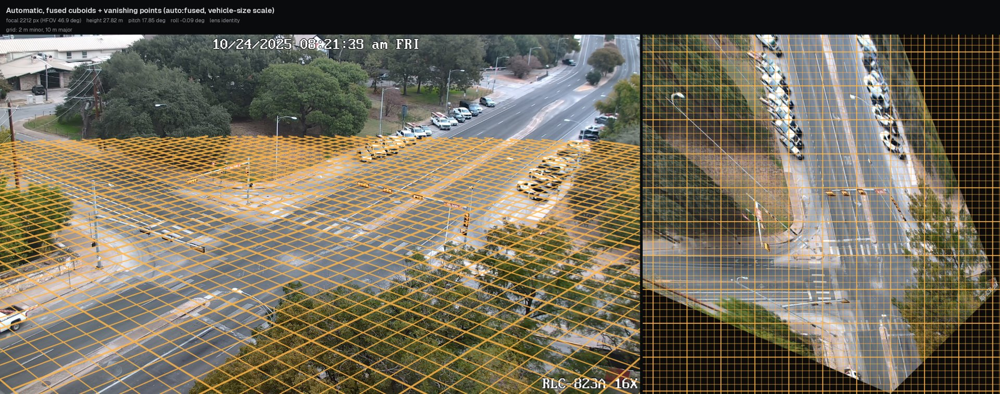
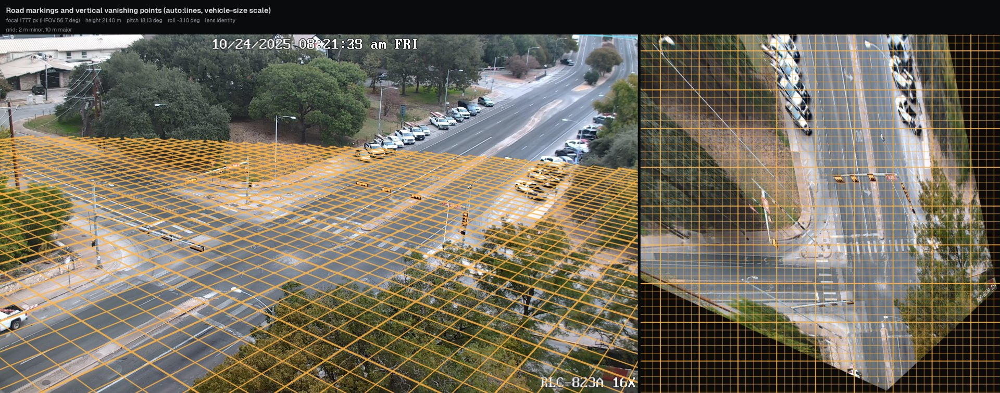
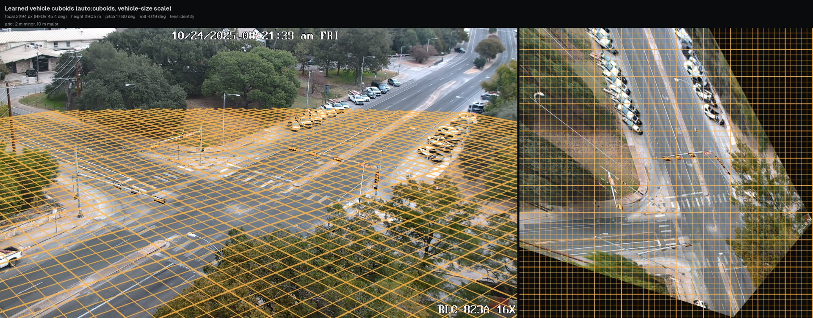
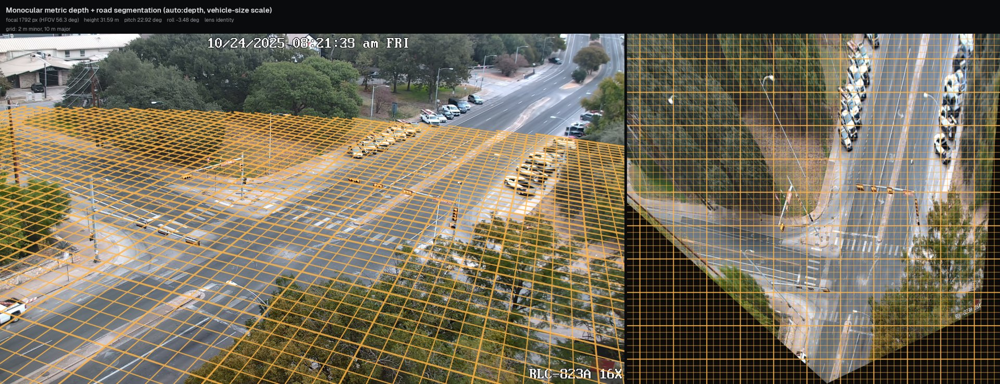
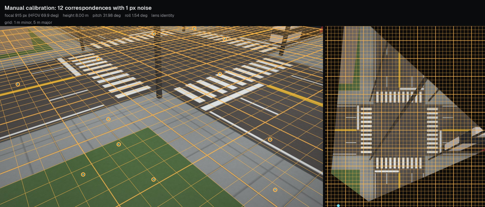

# Camera calibration

Every metric quantity in Tachymetry (position, speed, heading, footprint size) is obtained by intersecting a pixel ray with the ground plane $z = 0$. This page defines the camera model, lists the calibration methods with the inputs each one needs, and explains how to verify a result. The estimators are described in [Manual calibration](manual-calibration.md), [Automatic calibration](auto-calibration.md) and [Lens models](lens-models.md).

## Camera model and conventions

A calibrated camera is a `tachymetry.geometry.Camera`: a pinhole with intrinsics $K$, a radially symmetric lens model, and a pose $(R, t)$ above the ground plane (`geometry/camera.py`).

| Quantity | Convention |
|---|---|
| Image pixels $(u, v)$ | Origin at the centre of the top-left pixel, $u$ right, $v$ down. *Raw* pixels are as recorded; *rectified* pixels belong to the ideal pinhole image of the same size, after the lens model is removed. |
| World frame | Right-handed, metres, $z$ up, ground plane $z = 0$. Georeferenced cameras use $x$ east and $y$ north; otherwise the calibration chooses the yaw (typically $x$ along the main road) and the origin. |
| Camera frame | OpenCV: $x$ right, $y$ down, $z$ forward. |
| Extrinsics | $X_\mathrm{cam} = R X_\mathrm{world} + t$; camera centre $C = -R^\top t$; height $h = C_z$. |
| Angles | `yaw`: azimuth of the optical axis, counter-clockwise from world $+x$. `pitch`: depression below the horizon (positive looking down). `roll`: clockwise rotation of the image about the optical axis. |
| Intrinsics | Square pixels, $K = \begin{bmatrix} f & 0 & c_x \\ 0 & f & c_y \\ 0 & 0 & 1 \end{bmatrix}$, principal point fixed at the image centre $((w-1)/2, (h-1)/2)$ unless given. |

Lens distortion is a radial mapping between raw and rectified pixels ([Lens models](lens-models.md)); for wide-angle surveillance lenses the recommended model is the one-parameter equidistant-to-pinhole model `tan`, $r_u = s \tan(r_d / s)$ ([details](lens-models.md#recommended-model-equidistant-to-pinhole-tan)).

The ground-to-image homography of the rectified image is

$$
H = K \begin{bmatrix} r_1 & r_2 & t \end{bmatrix},
$$

where $r_1, r_2$ are the first two columns of $R$ (`Camera.H`; `Camera.H_inv` maps rectified pixels to the ground). `Camera.image_to_ground` rectifies raw pixels with the lens, back-projects the ray and intersects it with the plane $z = 0$ (or any horizontal plane $z$); rays at or above the horizon return `NaN`. `Camera.ground_sampling_distance(uv)` returns the largest singular value of the image-to-ground Jacobian, i.e. the ground extent of one pixel along its worst axis, in metres per pixel. This quantity bounds localisation accuracy and gates measurements throughout the pipeline (`hygiene.max_gsd_m = 0.30`).

Of the seven pose and intrinsic degrees of freedom (focal length, three angles, two ground coordinates, height), yaw and the ground position only choose the world frame unless the calibration is georeferenced. The height sets the metric scale of the world: a camera known up to scale is a valid projective model whose distances are all off by the same factor. Methods that observe only image geometry (vanishing points, footprint shape, gravity) therefore need a separate metric cue (see [Metric scale](#metric-scale)).

## Methods

| Method | Input | Estimates | Metric scale from | Entry point |
|---|---|---|---|---|
| `manual` | $\geq 4$ point correspondences (raw pixel to ground), optional straight polylines | $f$, yaw, pitch, roll, position, height, lens | the world coordinates | `calibrate_manual` |
| `lines` | one traffic-free image with painted markings | $f$, pitch, roll, lens (`tan` or division with `lens="auto"`) | a scale cue; otherwise relative (height 1) | `calibrate_from_lines` |
| `cuboids` | detections with predicted 3D cuboids, $\geq 40$ trusted car footprints | $f$, pitch, roll | passenger-car footprint statistics | `calibrate_from_cuboids` |
| `auto` | background image and detections | candidates `lines`, `cuboids`, `fused` (and `depth`, `geocalib` when enabled), ranked by consistency | vehicle footprints by default, or a scale cue | `calibrate_auto` |
| `depth` | one image; `pip install "tachymetry[depth]"` | $f$ (predicted), pitch, roll, height | the depth network, or `height=` | `calib.depth.calibrate_from_depth` |
| `geocalib` | one image; GeoCalib installed from its repository | $f$, pitch, roll, optional one-parameter lens | `height=` only; otherwise relative | `calib.geocalib_backend.calibrate_geocalib` |

`tachymetry run` and `tm.track` use `camera="auto"` by default: each video is calibrated with `calibrate_auto` on its background image and its own detections, and the result is cached in the run directory as `camera.json`. The cached camera is reused on later runs when its image size matches and its method name starts with `auto`.

## Choosing a method

| Available information | Recommended method | Notes |
|---|---|---|
| Orthophoto, site plan, survey or GPS points of ground features | `pick`, then `manual` | Most accurate in the [synthetic walkthrough](../examples/synthetic-calibration.md); georeferenced output with WGS84 GeoJSON when the points are latitude/longitude. |
| Video with moving and parked cars, default detector | `auto` | No user input. Needs at least 40 trusted car footprints for the cuboid and fused candidates and at least 10 for the vehicle-size scale. |
| Marked road, known camera height or lane width | `lines` with `--scale height=<m>` or `--scale lane_width=<m>` | Works on one image and needs no traffic. Without a cue the camera has relative scale (`meta["metric"] = False`). |
| Marked road and traffic | `auto` | Fuses footprints and vanishing points (`fused` candidate). |
| Single image, unmarked road | `depth`, or `geocalib` with a known height | Monocular depth scale can be wrong for unusual viewpoints; pass `height=` when known. |
| A previously calibrated camera of the same view at another resolution | pass the camera JSON | `Camera.resized` rescales $K$ and the lens to the new image size. |

## Command line

```bash
tachymetry calibrate auto clip.mp4 -o camera.json                 # detector on up to 90 s of video at 5 Hz
tachymetry calibrate lines clip.mp4 --scale height=8.5 -o camera.json
tachymetry calibrate cuboids clip.mp4 -o camera.json
tachymetry calibrate pick clip.mp4 --reference ortho.png --gsd 0.1 -o points.yaml
tachymetry calibrate manual clip.mp4 --points points.yaml -o camera.json
tachymetry calibrate depth clip.mp4 -o camera.json
tachymetry calibrate geocalib clip.mp4 -o camera.json
tachymetry calibrate preview clip.mp4 --camera camera.json -o preview.jpg
tachymetry run clip.mp4 --camera camera.json                      # use it
```

For a video, the calibration image is the temporal median of 41 frames spread over the clip (`calib._load_image_or_background`); an image file is used as is. Every command except `pick` and `preview` writes the camera (`-o`, default `camera.json`), a sidecar report `<stem>.report.json` with the full `CalibrationResult`, and a preview image (`--preview`, default `<stem>_preview.jpg`). `auto` and `cuboids` run the detector named by `--detector` (default `uod2-x`) on `--device` over up to 90 s of video at 5 frames per second (`calibrate_source(seconds=90.0, rate_hz=5.0)`). `--lens` selects the lens model: `auto` (default), `identity` or `none`, `tan` (alias `equidistant`) and `division` for `manual`, `lines` and `auto`; `brown` for `manual` only. `--scale` applies to `lines` and `auto`; for `depth` and `geocalib` pass the height from Python (below).

`tachymetry run --camera` also accepts a correspondence file, which is calibrated on the fly with `calibrate_manual`, and a directory holding `<video stem>.camera.json` or `<video stem>.json` files for batches of different cameras (`pipeline.resolve_camera`).

## Python

```python
import tachymetry as tm
from tachymetry.data import sample_video

clip = sample_video("intersection-day")            # public sample clip, downloaded once
cal = tm.calibrate(clip, method="lines", scale="height=27.8")
print(cal.summary())
cal.save("camera.json")                            # camera.json + camera.report.json
```

```text
[lines] f=1786.7px (hfov 56.5 deg), height=27.80 m, pitch=17.91 deg, roll=-3.05 deg, yaw=-52.1 deg, lens=identity; consistency 0.284
```

The height of 27.8 m is the camera height that the automatic calibration of this clip (vehicle-size scale) reported; a measured height takes its place when one is known. The saved camera is used with `tm.track(clip, camera="camera.json")` or `tachymetry run clip.mp4 --camera camera.json`.

`tm.calibrate(source, method, points=None, **kwargs)` forwards to `tachymetry.calib.calibrate_source`, which consumes `scale` (used by `lines` and `auto`), `lens` (`manual`, `lines`, `auto`), `detector`, `device`, `seconds` and `rate_hz` (`auto`, `cuboids`). Other keyword arguments are passed to the `manual`, `lines`, `cuboids`, `depth` and `geocalib` functions, e.g. `tm.calibrate("clip.mp4", method="depth", height=8.0)`. The methods are also available directly in `tachymetry.calib`:

```python
from tachymetry.calib import calibrate_auto, calibrate_from_cuboids, calibrate_from_lines, calibrate_manual
```

### `CalibrationResult`

| Field | Meaning |
|---|---|
| `camera` | The calibrated `Camera`. |
| `method` | `manual`, `lines`, `cuboids`, `fused`, `depth`, `geocalib`, or `auto:<selected>` for `calibrate_auto`. |
| `rmse_m` | In-sample ground residual in metres (manual calibration only). |
| `cv_rmse_m` | Cross-validated ground residual in metres (manual calibration only); the accuracy figure to report. |
| `residuals_m` | Per-correspondence ground residuals (manual calibration). |
| `score` | Self-consistency score in $[0, 1]$ used to rank automatic candidates; its definition differs between methods and is comparable only within one `calibrate_auto` call. |
| `details` | Diagnostics: vanishing points, footprint counts, lens search, candidate list, scale source, warnings. |

`CalibrationResult.save(path)` writes the camera and adds `meta["calibration"] = {method, rmse_m, cv_rmse_m, score}` to it. The camera JSON (`format: tachymetry.camera/1`) stores `image_size`, `K`, `R`, `t`, the lens, a `summary` (focal length, height, yaw, pitch, roll, horizontal field of view) and `H_image_to_ground` (rectified pixels to ground, normalised so that $H_{33} = 1$); see [Outputs](outputs.md).

## Metric scale

Methods that recover the camera only up to scale return a camera of height 1 and accept one metric cue, `ScaleCue` (`calib/from_lines.py`), given as a string, a number (height), a dictionary or an instance:

| Cue | Syntax | Computation |
|---|---|---|
| Camera height | `"height=8.5"`, `"h=8.5"`, `8.5` | `scale_to_height`: the world is scaled by $h_\mathrm{true} / h$. |
| Known ground distance | `ScaleCue(distance=((u1, v1), (u2, v2), d))` | `scale_from_distance`: the two raw pixels are back-projected and the world is scaled so that they are $d$ metres apart. |
| Lane width | `"lane_width=3.5"`, `"lane=3.5"` | `scale_from_lane_spacing`: lateral offsets of the longer half of the main-direction marking segments; the period that best explains all pairwise offset differences as integer multiples (searched over 0.4 to 2.0 times the expected width) is taken as one lane width. |
| Vehicles | `"vehicles"` (default of `calibrate_auto`) | `footprint_scale` on car footprints (below). |

The vehicle-size cue uses the median passenger-car footprint, $L_0 = 4.6$ m by $W_0 = 1.85$ m (`calib/scale.py`, configurable as `calibration.car_length_m` and `calibration.car_width_m`). `footprint_scale` (`calib/from_cuboids.py`) back-projects the trusted car footprints with the camera. Each footprint then contributes the dimension that lies across its viewing ray, because distances along the ray are far more sensitive to pitch and corner errors. With $\gamma$ the angle between the footprint axis and the ray to its centroid:

- a footprint seen roughly head-on ($|\cos\gamma| > 0.5$) gives $s = W_0 / W$;
- one seen roughly from the side ($|\cos\gamma| < 0.85$) gives $s = L_0 / L$;
- oblique footprints give both.

The scale is the weighted median of these estimates. Width estimates carry 4 times the footprint's diversity weight and length estimates once, because car widths vary about half as much as car lengths. At least 10 footprints are required by `calibrate_auto`. The older `scale_from_vehicle_sizes` (`calib/scale.py`), which combines the median length and width in the log domain with inverse-variance weights for assumed dispersions of 12 % and 6 %, remains available.

The prior is a population median. A fleet whose median car differs from 4.6 m by 1.85 m biases all distances and speeds by the same factor, and so does a detector that maps smaller vehicles, such as three-wheelers, to `car` ([Limitations](../limitations.md#mixed-traffic-and-class-dependent-scale)).

## Implausible automatic calibrations

`Pipeline` checks each automatic calibration before using it:

- **No metric scale.** A camera without one (the detector provides no cuboids and no scale cue was given) raises `CalibrationError` with instructions.
- **Implausible height.** A camera placed more than `MAX_PLAUSIBLE_HEIGHT_M` = 250 m above the ground (`pipeline.py`) raises a `UserWarning`, and the note is stored in `camera.meta["warnings"]`, so it is also written to `camera.json`. The run continues with that camera.

The known failure case is straight-down drone footage. There the cuboid solver mistakes the detector's footprint bias for perspective and returns a strongly tilted camera with a long focal length at a large height; on the straight-down sample, 1343 m. Supply the camera for such footage ([Drone footage](../examples/drone.md)). Heights below the threshold are not checked, so inspect the preview of each new viewpoint.

Straight-down cameras (pitch 90°) are supported when given explicitly:

- `Camera.below_horizon` accepts all finite pixels, since the image contains no horizon.
- The bird's-eye view is oriented by `Camera.ground_up()`, the ground direction that appears as up in the image. It is defined for pitches from level to straight down.

## Verifying a calibration

A calibration is accepted when its ground grid lies flat on the road and the bird's-eye view shows parallel lane lines and rectangular crosswalks. `tachymetry.calib.preview(image, camera)` composes:

- **Left:** the camera view with a metric ground grid (1 m minor and 5 m major lines; 2 m and 10 m for views spanning more than 70 m, 5 m and 25 m beyond 160 m). Grid lines are sampled densely and projected through the lens, so they bend under distortion. They are drawn only where the ground sampling distance is at most 0.30 m per pixel. The cyan line is the horizon.
- **Right:** the orthorectified bird's-eye view (`warp_to_bev`, 0.04 m per pixel, at most 1400 px on its long side) of the usable ground, with the same grid and the camera position as a cyan dot.
- **Header:** focal length, horizontal field of view, height, pitch, roll and lens model.

`compare(image, [(name, camera), ...])` tiles several previews, e.g. the candidates of `calibrate_auto`, which are kept in `result.details["candidate_cameras"]` (removed before saving). `warp_to_bev(image, camera, extent=None, resolution=0.05)` returns the orthorectified image, its ground extent `(x_min, x_max, y_min, y_max)` and resolution; rows run from $y_\mathrm{max}$ at the top to $y_\mathrm{min}$.

Typical failure signatures in the preview:

| Observation in the bird's-eye view | Likely cause |
|---|---|
| Lane lines converge or diverge with range; crosswalk stripes are trapezoids | Pitch or focal length error (the two are correlated) |
| Lane lines bend towards the image corners | Uncorrected lens distortion |
| Rectangles are sheared | Roll error |
| Correct shapes, but a lane is not about 3 to 3.7 m wide against the grid | Metric scale error |
| Grid does not reach the far road | Expected: the far field exceeds 0.30 m per pixel |

<figure markdown="span">
  
  <figcaption>Automatic calibration of the public sample clip (`auto:fused`): ground grid in the camera view (left) and orthorectified bird's-eye view (right).</figcaption>
</figure>

<figure markdown="span">
  
  <figcaption>The same clip calibrated from road markings and vertical structures only (`lines`), scaled from vehicle footprints.</figcaption>
</figure>

<figure markdown="span">
  
  <figcaption>The same clip calibrated from learned vehicle cuboids only (`cuboids`).</figcaption>
</figure>

<figure markdown="span">
  
  <figcaption>The same clip calibrated from monocular metric depth and road segmentation (`depth`).</figcaption>
</figure>

<figure markdown="span">
  
  <figcaption>Manual calibration of a synthetic intersection from 12 noisy correspondences (see the [synthetic walkthrough](../examples/synthetic-calibration.md)).</figcaption>
</figure>
