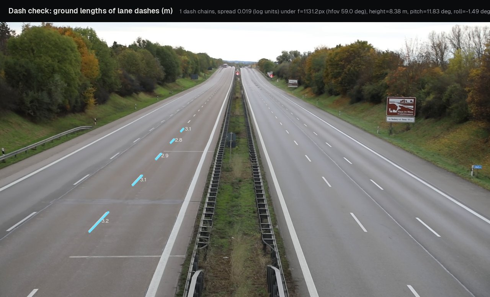
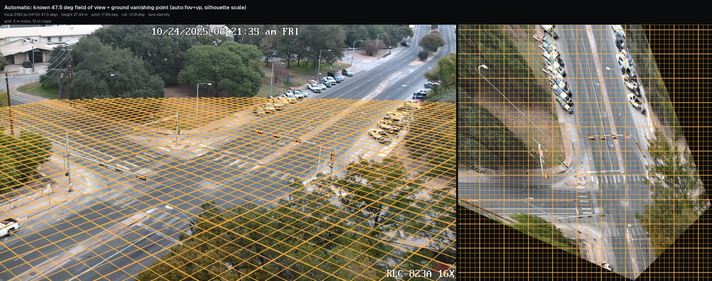

# Camera calibration

Each metric quantity in Tachymetry (position, speed, heading, footprint size) is obtained by intersecting a pixel ray with the ground plane $z = 0$. This page defines the camera model, lists the calibration methods with the inputs each one needs, and explains how to verify a result. The estimators are described in [Manual calibration](manual-calibration.md), [Automatic calibration](auto-calibration.md) and [Lens models](lens-models.md).

## Camera model and conventions

A calibrated camera is a `tachymetry.geometry.Camera`: a pinhole with intrinsics $K$, a radially symmetric lens model, and a pose $(R, t)$ above the ground plane (`geometry/camera.py`).

| Quantity | Convention |
|---|---|
| Image pixels $(u, v)$ | Origin at the centre of the top-left pixel, $u$ right, $v$ down. *Raw* pixels are as recorded; *rectified* pixels belong to the ideal pinhole image of the same size, after the lens model is removed. |
| World frame | Right-handed, metres, $z$ up, ground plane $z = 0$. Georeferenced cameras use $x$ east and $y$ north; otherwise the calibration chooses the yaw (typically $x$ along the main road) and the origin. |
| Camera frame | OpenCV: $x$ right, $y$ down, $z$ forward. |
| Extrinsics | $X_\mathrm{cam} = R X_\mathrm{world} + t$; camera centre $C = -R^\top t$; height $h = C_z$. |
| Angles | `yaw`: azimuth of the optical axis, counter-clockwise from world $+x$. `pitch`: depression below the horizon (positive looking down). `roll`: clockwise rotation of the image about the optical axis. |
| Intrinsics | Square pixels, $K = \begin{bmatrix} f & 0 & c_x \\ 0 & f & c_y \\ 0 & 0 & 1 \end{bmatrix}$, principal point fixed at the image centre $((w-1)/2, (h-1)/2)$ unless given. |

Lens distortion is a radial mapping between raw and rectified pixels ([Lens models](lens-models.md)); for wide-angle surveillance lenses the recommended model is the one-parameter equidistant-to-pinhole model `tan`, $r_u = s \tan(r_d / s)$ ([details](lens-models.md#recommended-model-equidistant-to-pinhole-tan)).

The ground-to-image homography of the rectified image is

$$
H = K \begin{bmatrix} r_1 & r_2 & t \end{bmatrix},
$$

where $r_1, r_2$ are the first two columns of $R$ (`Camera.H`; `Camera.H_inv` maps rectified pixels to the ground). `Camera.image_to_ground` rectifies raw pixels with the lens, back-projects the ray and intersects it with the plane $z = 0$ (or another horizontal plane $z$); rays at or above the horizon return `NaN`. `Camera.ground_sampling_distance(uv)` returns the largest singular value of the image-to-ground Jacobian, i.e. the ground extent of one pixel along its worst axis, in metres per pixel. This quantity bounds localisation accuracy and gates measurements throughout the pipeline (`hygiene.max_gsd_m = 0.30`).

Of the seven pose and intrinsic degrees of freedom (focal length, three angles, two ground coordinates, height), yaw and the ground position only choose the world frame unless the calibration is georeferenced. The height sets the metric scale of the world: a camera known up to scale is a valid projective model whose distances are all off by the same factor. Methods that observe only image geometry (vanishing points, gravity) therefore need a separate metric cue (see [Metric scale](#metric-scale)).

## Methods

| Method | Input | Estimates | Metric scale from | Entry point |
|---|---|---|---|---|
| `manual` | $\geq 4$ point correspondences (raw pixel to ground), optional straight polylines | $f$, yaw, pitch, roll, position, height, lens | the world coordinates | `calibrate_manual` |
| `lines` | one traffic-free image with painted markings: a ground direction plus vertical structures, or two orthogonal ground directions | $f$, pitch, roll, lens (`tan` or division with `lens="auto"`) | a scale cue; otherwise relative (height 1) | `calibrate_from_lines` |
| `fov+vp` | the lens's horizontal field of view (`calibration.hfov_deg`, `--hfov`) and one ground vanishing point | pitch, roll ($f$ from the field of view) | vehicle silhouettes, or a scale cue | candidate of `calibrate_auto` |
| `cuboids` | detections with predicted 3D cuboids (`uod2-*`), $\geq 40$ trusted car footprints | $f$, pitch, roll | passenger-car footprint statistics | `calibrate_from_cuboids` |
| `auto` | background image and detections | candidates `lines`, `fov+vp` (with a field of view), `cuboids` and `fused` (with cuboids), `depth` and `geocalib` (when enabled), ranked by consistency | vehicle silhouettes (instance masks), car footprints (cuboids), or a scale cue | `calibrate_auto` |
| `depth` | one image; `pip install "tachymetry[depth]"` | $f$ (predicted), pitch, roll, height | the depth network, or `height=` | `calib.depth.calibrate_from_depth` |
| `geocalib` | one image; GeoCalib installed from its repository | $f$, pitch, roll, optional one-parameter lens | `height=` only; otherwise relative | `calib.geocalib_backend.calibrate_geocalib` |

`tachymetry run` and `tm.track` use `camera="auto"` by default: each video is calibrated with `calibrate_auto` on its background image and its own detections, and the result is cached in the run directory as `camera.json`. With the default detector, SAM 3, the detections carry instance masks. The orientation comes from the `lines` candidate, or from `fov+vp` when `calibration.hfov_deg` is set, and the metric scale from car silhouettes. The `cuboids` and `fused` candidates and the footprint scale exist only with the cuboid detector UrbanOmniDetect-2 (`uod2-*`, optional `uod2` extra). The cached camera is reused on later runs when its image size matches and its method name starts with `auto`.

## Choosing a method

| Available information | Recommended method | Notes |
|---|---|---|
| Orthophoto, site plan, survey or GPS points of ground features | `pick`, then `manual` | Most accurate in the [synthetic walkthrough](../examples/synthetic-calibration.md); georeferenced output with WGS84 GeoJSON when the points are latitude/longitude. |
| Video with traffic, known horizontal field of view of the lens (data sheet, or GeoCalib on a few frames) | `auto` with `--hfov` or `calibration.hfov_deg` | The field of view is authoritative: candidates whose focal length differs from it by more than 10 % are dropped. One ground vanishing point is enough, so scenes with a single road direction calibrate. |
| Video with traffic, marked road with vertical structures or two orthogonal road directions | `auto` | The `lines` candidate gives the orientation and the car silhouettes the scale. Check the preview and the [dash regularity](#dash-regularity); the focal length from vanishing points can be off by tens of percent (see [one camera, several clips](#one-camera-several-clips)). |
| Marked road, known camera height or lane width | `lines` with `--scale height=<m>` or `--scale lane_width=<m>` | Works on one image and needs no traffic. Without a cue the camera has relative scale (`meta["metric"] = False`). |
| Several clips from one fixed camera | calibrate the clip with the clearest evidence once and pass its `camera.json` to the others | See [one camera, several clips](#one-camera-several-clips). |
| Straight-down drone footage | a known camera from the flight altitude and the lens's field of view | Automatic calibration assumes an oblique view ([Drone footage](../examples/drone.md)). |
| Single image, unmarked road | `depth`, or `geocalib` with a known height | Monocular depth scale can be wrong for unusual viewpoints; pass `height=` when known. |
| Cuboid detector (`uod2-*`) | `auto` | Adds the `cuboids` and `fused` candidates and the footprint scale. |
| A previously calibrated camera of the same view at another resolution | pass the camera JSON | `Camera.resized` rescales $K$ and the lens to the new image size. |

## Command line

```bash
tachymetry calibrate auto clip.mp4 -o camera.json                  # SAM 3 on up to 90 s of video at 5 Hz
tachymetry calibrate auto clip.mp4 --hfov 47.5 -o camera.json      # known horizontal field of view (degrees)
tachymetry calibrate lines clip.mp4 --scale height=8.5 -o camera.json
tachymetry calibrate cuboids clip.mp4 --detector uod2-x -o camera.json   # needs the uod2 extra
tachymetry calibrate pick clip.mp4 --reference ortho.png --gsd 0.1 -o points.yaml
tachymetry calibrate manual clip.mp4 --points points.yaml -o camera.json
tachymetry calibrate depth clip.mp4 -o camera.json
tachymetry calibrate geocalib clip.mp4 -o camera.json
tachymetry calibrate preview clip.mp4 --camera camera.json -o preview.jpg
tachymetry run clip.mp4 --camera camera.json                       # use it
tachymetry run clip.mp4 --set calibration.hfov_deg=47.5            # or calibrate in the run with a known field of view
```

For a video, the calibration image is the temporal median of 41 frames spread over the clip (`calib._load_image_or_background`); an image file is used as is. Each command except `pick` and `preview` writes the camera (`-o`, default `camera.json`), a sidecar report `<stem>.report.json` with the full `CalibrationResult`, and a preview image (`--preview`, default `<stem>_preview.jpg`).

- **Detector.** `auto` and `cuboids` run the detector named by `--detector` (default `sam3`) on `--device` over up to 90 s of video at 5 frames per second (`calibrate_source(seconds=90.0, rate_hz=5.0)`). SAM 3 needs approved access to its gated checkpoint ([Detection](detection.md)).
- **`--hfov`** applies to `auto`.
- **`--lens`** selects the lens model: `auto` (default), `identity` or `none`, `tan` (alias `equidistant`) and `division` for `manual`, `lines` and `auto`; `brown` for `manual` only.
- **`--scale`** applies to `lines` and `auto`; for `depth` and `geocalib` pass the height from Python (below).

On the public intersection clip, `tachymetry calibrate auto <clip> --hfov 47.5 -o camera.json` prints

```text
[auto:fov+vp] f=2181.8px (hfov 47.5 deg), height=27.26 m, pitch=17.88 deg, roll=-0.01 deg, yaw=134.0 deg, lens=identity; consistency 0.553
Camera: camera.json
Preview: camera_preview.jpg
```

It took 55 s and 95 s in two runs on one GPU (the second with other jobs on the machine), most of it SAM 3 detection and its model load.

`tachymetry run --camera` also accepts a correspondence file, which is calibrated on the fly with `calibrate_manual`, and a directory holding `<video stem>.camera.json` or `<video stem>.json` files for batches of different cameras (`pipeline.resolve_camera`).

## Python

```python
import tachymetry as tm
from tachymetry.data import sample_video

clip = sample_video("intersection-day")            # public sample clip, downloaded once
cal = tm.calibrate(clip, method="lines", scale="height=27.7")
print(cal.summary())
cal.save("camera.json")                            # camera.json + camera.report.json
```

```text
[lines] f=1786.7px (hfov 56.5 deg), height=27.70 m, pitch=17.91 deg, roll=-3.05 deg, yaw=-52.1 deg, lens=identity; consistency 0.284
```

The height of 27.7 m is that of the camera shared by the intersection samples (`tachymetry/assets/cameras/svbrd-intersection.json`); a measured height takes its place when one is known. The vanishing points of this view give a focal length of 1787 px (56.5° horizontal field of view). The lens's field of view is 47.5° (2182 px): GeoCalib gave focal lengths of 2053 to 2359 px on four clips of the same camera (comment in `tachymetry/data.py`). With the field of view given, automatic calibration drops the `lines` candidate for that reason (`details["errors"]["lines"]`) and uses the `fov+vp` candidate:

```python
cal = tm.calibrate(clip, method="auto", hfov_deg=47.5)   # SAM 3 on up to 90 s of video at 5 Hz (GPU)
print(cal.summary())
print(cal.details["scale"])
```

```text
[auto:fov+vp] f=2181.8px (hfov 47.5 deg), height=27.26 m, pitch=17.88 deg, roll=-0.01 deg, yaw=134.0 deg, lens=identity; consistency 0.553
{'scale': 'vehicle silhouettes', 'factor': 27.25860578412651, 'cost': 0.6246189389544407, 'n_masks': 98, 'n_tracklets': 27}
```

These detections are sampled at 5 Hz, whereas the packaged camera (27.7 m) was calibrated on the detections of a full run at 15 Hz. No chain of five or more dashes lies on the road surface of this intersection, so the [dash check](#dash-regularity) does not apply.

`tm.calibrate(source, method, points=None, **kwargs)` forwards to `tachymetry.calib.calibrate_source`, which consumes `scale` (used by `lines` and `auto`), `lens` (`manual`, `lines`, `auto`), `detector` (default `"sam3"`), `device`, `seconds`, `rate_hz` (`auto`, `cuboids`) and `hfov_deg` (`auto`). Other keyword arguments are passed to the `manual`, `lines`, `cuboids`, `depth` and `geocalib` functions, e.g. `tm.calibrate("clip.mp4", method="depth", height=8.0)`. The methods are also available directly in `tachymetry.calib`:

```python
from tachymetry.calib import calibrate_auto, calibrate_from_cuboids, calibrate_from_lines, calibrate_manual
```

### `CalibrationResult`

| Field | Meaning |
|---|---|
| `camera` | The calibrated `Camera`. |
| `method` | `manual`, `lines`, `cuboids`, `fused`, `fov+vp`, `depth`, `geocalib`, or `auto:<selected>` for `calibrate_auto`. |
| `rmse_m` | In-sample ground residual in metres (manual calibration only). |
| `cv_rmse_m` | Cross-validated ground residual in metres (manual calibration only); the accuracy figure to report. |
| `residuals_m` | Per-correspondence ground residuals (manual calibration). |
| `score` | Self-consistency score in $[0, 1]$ used to rank automatic candidates; its definition differs between methods and is comparable only within one `calibrate_auto` call. |
| `details` | Diagnostics: vanishing points, scale source and fit, candidate list with consistency terms and dash regularity, the reasons why candidates failed or were dropped (`errors`). |

`CalibrationResult.save(path)` writes the camera and adds `meta["calibration"] = {method, rmse_m, cv_rmse_m, score}` to it. The camera JSON (`format: tachymetry.camera/1`) stores `image_size`, `K`, `R`, `t`, the lens, a `summary` (focal length, height, yaw, pitch, roll, horizontal field of view) and `H_image_to_ground` (rectified pixels to ground, normalised so that $H_{33} = 1$); see [Outputs](outputs.md).

## Metric scale

Methods that recover the camera only up to scale return a camera of height 1 and accept one metric cue, `ScaleCue` (`calib/from_lines.py`), given as a string, a number (height), a dictionary or an instance:

| Cue | Syntax | Computation |
|---|---|---|
| Camera height | `"height=8.5"`, `"h=8.5"`, `8.5` | `scale_to_height`: the world is scaled by $h_\mathrm{true} / h$. |
| Known ground distance | `ScaleCue(distance=((u1, v1), (u2, v2), d))` | `scale_from_distance`: the two raw pixels are back-projected and the world is scaled so that they are $d$ metres apart. |
| Lane width | `"lane_width=3.5"`, `"lane=3.5"` | `scale_from_lane_spacing`: lateral offsets of the longer half of the main-direction marking segments; the period that best explains all pairwise offset differences as integer multiples (searched over 0.4 to 2.0 times the expected width) is taken as one lane width. |
| Vehicles | `"vehicles"` (default of `calibrate_auto`) | `silhouette_scale` when the detections carry instance masks, otherwise `footprint_scale` on cuboid footprints (below). |

**Vehicle silhouettes** (`calib/from_silhouettes.py`; detectors with instance masks: `sam3`, `rfdetr-seg-*`). A passenger car is modelled as a rigid body of 4.5 m by 1.85 m by 1.5 m: a lower body up to the beltline and a shorter, narrower cabin above it. For a camera of fixed orientation, the projection of this model explains the cars' instance masks only at the right metric scale.

- **Search.** The scale factor is found by a search on its logarithm over short tracklets of confident, untruncated car masks.
- **Cost.** The silhouette cost is asymmetric: it lets the model overhang where an occluder hides the car ([Automatic calibration](auto-calibration.md#metric-scale-from-vehicle-silhouettes)).
- **Acceptance.** The fit needs at least 6 tracklets and 8 masks and is rejected when its mean cost exceeds 1.2.
- **Model width.** `calibration.car_width_m` sets it.

The criterion constrains the scale well, but the focal length and the pitch only weakly, so the orientation must come from geometric evidence: vanishing points, a known field of view, GeoCalib or correspondences.

**Car footprints** (`calib/from_cuboids.py`, cuboid detector `uod2-*`). `footprint_scale` back-projects the trusted car footprints with the camera. Each footprint then contributes the dimension that lies across its viewing ray, because distances along the ray are far more sensitive to pitch and corner errors. With $\gamma$ the angle between the footprint axis and the ray to its centroid:

- a footprint seen roughly head-on ($|\cos\gamma| > 0.5$) gives $s = W_0 / W$;
- one seen roughly from the side ($|\cos\gamma| < 0.85$) gives $s = L_0 / L$;
- oblique footprints give both.

Here $L_0 = 4.6$ m and $W_0 = 1.85$ m (`calibration.car_length_m`, `calibration.car_width_m`). The scale is the weighted median of these estimates. Width estimates carry 4 times the footprint's diversity weight and length estimates once, because car widths vary about half as much as car lengths. At least 10 footprints are required. The older `scale_from_vehicle_sizes` (`calib/scale.py`) remains available. It combines the median length and width in the log domain, with inverse-variance weights for assumed dispersions of 12 % and 6 %.

Both vehicle cues assume a population of passenger cars. A fleet whose median car differs from the model biases all distances and speeds by the same factor, and so does a detector that maps smaller vehicles, such as three-wheelers, to `car` ([Limitations](../limitations.md#mixed-traffic-and-class-dependent-scale)).

## Implausible automatic calibrations

`Pipeline` checks each automatic calibration before using it:

- **No metric camera.** When neither instance masks nor cuboids give a scale, or the car silhouettes do not fit the estimated orientation, and no scale cue was given, `CalibrationError` is raised. The message lists the remedies: the lens field of view (`--set calibration.hfov_deg=<degrees>`), a scale cue (`--set calibration.scale=height=<metres>` or `lane_width=<metres>`), or manual calibration.
- **Implausible height.** A camera placed more than `MAX_PLAUSIBLE_HEIGHT_M` = 250 m above the ground (`pipeline.py`) raises a `UserWarning`, and the note is stored in `camera.meta["warnings"]`, so it is also written to `camera.json`. The run continues with that camera.
- **Irregular lane dashes.** `calibrate_auto` warns when the dashes of dashed lane lines change length along the road under the selected camera ([dash regularity](#dash-regularity)).

Straight-down drone footage is a known failure case of automatic calibration; supply the camera for such footage ([Drone footage](../examples/drone.md)). Heights below the threshold are not checked, so inspect the preview of each new viewpoint.

Straight-down cameras (pitch 90°) are supported when given explicitly:

- `Camera.below_horizon` accepts all finite pixels, since the image contains no horizon.
- The bird's-eye view is oriented by `Camera.ground_up()`, the ground direction that appears as up in the image. It is defined for pitches from level to straight down.

## Calibration verification

### Preview

A calibration is accepted when its ground grid lies flat on the road and the bird's-eye view shows parallel lane lines and rectangular crosswalks. `tachymetry.calib.preview(image, camera)` composes:

- **Left:** the camera view with a metric ground grid (1 m minor and 5 m major lines; 2 m and 10 m for views spanning more than 70 m, 5 m and 25 m beyond 160 m). Grid lines are sampled densely and projected through the lens, so they bend under distortion. They are drawn only where the ground sampling distance is at most 0.30 m per pixel. The cyan line is the horizon.
- **Right:** the orthorectified bird's-eye view (`warp_to_bev`, 0.04 m per pixel, at most 1400 px on its long side) of the usable ground, with the same grid and the camera position as a cyan dot.
- **Header:** focal length, horizontal field of view, height, pitch, roll and lens model.

`compare(image, [(name, camera), ...])` tiles several previews, e.g. the candidates of `calibrate_auto`, which are kept in `result.details["candidate_cameras"]` (removed before saving). `warp_to_bev(image, camera, extent=None, resolution=0.05)` returns the orthorectified image, its ground extent `(x_min, x_max, y_min, y_max)` and resolution; rows run from $y_\mathrm{max}$ at the top to $y_\mathrm{min}$.

Typical failure signatures in the preview:

| Observation in the bird's-eye view | Likely cause |
|---|---|
| Lane lines converge or diverge with range; crosswalk stripes are trapezoids | Pitch or focal length error (the two are correlated) |
| Lane lines bend towards the image corners | Uncorrected lens distortion |
| Rectangles are sheared | Roll error |
| Correct shapes, but a lane is not about 3 to 3.7 m wide against the grid | Metric scale error |
| Grid does not reach the far road | Expected: the far field exceeds 0.30 m per pixel |

### Dash regularity

A dashed lane line repeats one dash length and one period along the road. Under the correct camera, the ground lengths of its dashes and the distances between consecutive dashes are the same near and far. A camera whose horizon does not pass through the line's vanishing point makes them grow or shrink with distance. `calib/from_markings.py` measures this without a scale:

1. **Road surface** (`road_region`). The search is restricted to the region swept by the vehicles: the convex hull of the box bottom-centres of confident vehicle detections (cars, buses, trucks and motorcycles with a score of at least 0.5; at least 10 of them), dilated by 4 % of the image width. Without it, regular structures off the road, such as signal mast arms or facades, are mistaken for dash chains.
2. **Dash chains** are found without a camera (`dashed_lines`). Elongated components of the road-marking mask are grouped into lines by RANSAC. A run of dashes is kept where the starts of each four consecutive dashes have the cross-ratio 4/3 within 6 %: equally spaced ground points keep this cross-ratio under perspective projection, which rejects crosswalk bars, arrows, fragments of solid lines and missing dashes. The run must also be in perspective order: its image gaps shrink monotonically towards one end, and its dash lengths follow, with one exception allowed for worn paint.
3. **Regularity** (`marking_regularity`) back-projects the dash ends with the camera. It returns the RMS, in log units, of the deviations of the dash lengths from their median and of the periods from integer multiples of their median (missing dashes are allowed). Residuals are weighted by the square root of each dash's image length.
4. **Use in automatic calibration.** Only chains of five or more dashes, i.e. two independent cross-ratio tests, are trusted. When at least one exists, each candidate's consistency score is multiplied by $e^{-\rho / 0.1}$, where $\rho$ is its regularity, and a warning is issued when the selected camera has $\rho > 0.12$.

The check constrains only the horizon. When all dashed lines are parallel, all cameras whose horizon passes through their common vanishing point make them regular, whatever the focal length. It detects gross errors rather than errors of a few degrees.

On the motorway sample, one chain of five dashes is found, between 23 and 58 m from the camera. Its regularity under two cameras:

- **Automatic camera** ($f$ = 1131 px from the 59° field of view, pitch 11.8°, roll −1.5°, height 8.4 m from the silhouette scale): $\rho$ = 0.019. The dashes measure 2.85 to 3.16 m with periods of 8.90 to 9.38 m, close to the 3 m dashes and 9 m periods of the markings.
- **Earlier calibration from UrbanOmniDetect-2 cuboids** ($f$ = 2072 px, pitch 9.8°, height 15.3 m): $\rho$ = 0.165. The same dashes grow from 3.35 m at the far end to 6.28 m at the near end.

Changing the pitch of the automatic camera by ±2° gives $\rho$ = 0.065 and 0.086; changing its field of view to 50° or 68° at the same pitch gives 0.096 and 0.059. All of these remain below the warning threshold.

On the intersection samples and the synthetic intersection of the [walkthrough](../examples/synthetic-calibration.md), the road region contains no chain of five or more dashes, so the check does not apply there.

<figure markdown="span">
  
  <figcaption>Dash chains detected on the background of the motorway sample, with their ground lengths under its automatic camera.</figcaption>
</figure>

### One camera, several clips

A fixed camera has one calibration. Calibrating each of its clips separately adds the per-clip variance of automatic calibration to the measurements. Instead, calibrate the clip with the clearest evidence once and pass its camera file to the others: `camera="camera.json"`, `--camera camera.json`, or a directory of per-video cameras.

The five intersection samples come from one camera. Each background was registered to that of `intersection-day` with a homography fitted to ORB feature matches, and the displacement was measured over a 9 by 5 grid of image points:

- `intersection-day-2` and `intersection-day-3`: at most 0.28 px;
- `intersection-turn`: at most 4.2 px;
- `intersection-night` (infrared): median 3.4 px, up to 12.4 px at the image corners. This clip matches less reliably.

Each clip was then calibrated separately with `calibrate_auto(background, detections, CalibrationConfig(hfov_deg=47.5))`, on the SAM 3 detections of its full run:

| Clip | Selected | Height (m) | Pitch (deg) | Roll (deg) | Silhouette cost | Without the field of view: height (m), $f$ (px) |
|---|---|---|---|---|---|---|
| `intersection-day` | `fov+vp` | 27.44 | 17.89 | −0.18 | 0.75 | 18.54, 1777 |
| `intersection-day-2` | `fov+vp` | 26.57 | 17.63 | 0.23 | 0.41 | 19.70, 1836 |
| `intersection-day-3` | `fov+vp` | 30.91 | 18.84 | 1.48 | 0.37 | 17.65, 1733 |
| `intersection-turn` | `fov+vp` | 30.40 | 20.66 | 3.60 | 0.82 | 19.64, 1768 |
| `intersection-night` | `lines` ($f$ = 2197 px) | 34.40 | 22.20 | −2.47 | 0.26 | 34.40, 2197 |

With the same field of view, the heights span 26.6 to 34.4 m, the pitches 17.6° to 22.2° and the rolls −2.5° to 3.6° for one camera pose. Without the field of view, the `lines` candidate of the daytime clips gives focal lengths 16 to 21 % shorter and heights of 17.7 to 19.7 m. The samples therefore share one camera. `intersection-day` is calibrated with its 47.5° field of view. The other four load the packaged camera `tachymetry/assets/cameras/svbrd-intersection.json` ($f$ = 2182 px, height 27.7 m, pitch 17.9°, roll −0.18°) through `tachymetry.data.sample_camera`, an earlier calibration of `intersection-day` whose lane widths (3.43 to 3.45 m) and dash lengths (2.7 to 3.1 m) match the markings; the current calibration of the clip is 1 % lower.

<figure markdown="span">
  
  <figcaption>Automatic calibration of `intersection-day` with its 47.5° field of view: main ground vanishing point and vehicle-silhouette scale. Ground grid in the camera view (left) and orthorectified bird's-eye view (right).</figcaption>
</figure>

<figure markdown="span">
  
  <figcaption>The same clip calibrated from road markings and vertical structures (`lines`) without a field of view, scaled from vehicle silhouettes.</figcaption>
</figure>

<figure markdown="span">
  
  <figcaption>The same clip calibrated from monocular metric depth and road segmentation (`depth`), scaled from vehicle silhouettes.</figcaption>
</figure>

<figure markdown="span">
  
  <figcaption>Manual calibration of a synthetic intersection from 12 noisy correspondences (see the [synthetic walkthrough](../examples/synthetic-calibration.md)).</figcaption>
</figure>
