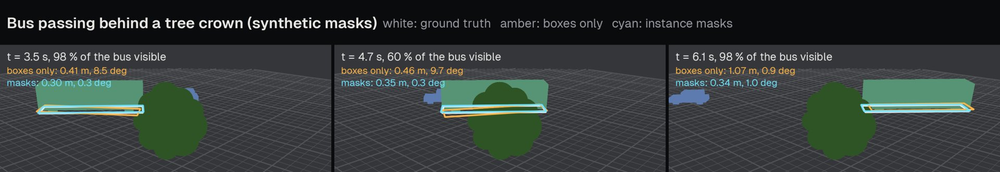

# Vehicle footprints from masks

For a segmenting detector (`sam3`, the default, or `rfdetr-seg-*`), each vehicle detection carries an instance mask. The mask path of track hygiene (`tracking/maskgeom.py`) estimates, for each vehicle track, a calibrated upright box. Its outputs are a footprint rectangle on the ground (centre, heading, length and width) per sample, and a height and a clearance per track. This page describes the model and the estimator; the box-only path that persons, two-wheelers and detectors without masks use is described in [Association and track hygiene](tracking.md#centre-estimation).

The mask path runs when `hygiene.footprints` and `hygiene.mask_geometry` are on (the default), for vehicle tracks that have masks on at least `mask_min_share` = 0.5 of their usable samples. `hygiene.boxfit` (on by default) enables the box fit within it.

## Box model and silhouette cost

A vehicle is an upright box of length $L$, width $W$ and roof height $H$, standing on the ground plane $z = 0$ with heading $\theta$ (`geometry/silhouette.py`).

- **Clearance.** The bottom face of the box is placed at the clearance $g$ rather than at $z = 0$. The lowest edge that an instance mask shows between the wheels is the sill or the underbody, because tyres and the dark underside are often not segmented. Projecting that edge at $z = 0$ would displace the vehicle away from the camera by $g\,d / h$, for range $d$ and camera height $h$.
- **Silhouette.** The image of the box under the calibrated camera, with the lens model applied, is the convex hull $S$ of its eight projected corners.

For a mask $M$ in the image frame $F$, the cost of a box pose is

$$
c = w_\mathrm{miss}\,\frac{|M \setminus S|}{|M|} + w_\mathrm{extra}\,\frac{|(S \cap F) \setminus M|}{|M|} + w_\mathrm{edge}\,\mathrm{chamfer}(\partial S, \partial M),
$$

with $w_\mathrm{miss} = 5$, $w_\mathrm{extra} = 0.7$ and $w_\mathrm{edge} = 0.05$ (`silhouette_cost`).

- **Asymmetry.** The asymmetry encodes occlusion: all segmented pixels must lie inside the silhouette, while the silhouette may extend beyond the mask where an occluder or the frame edge removed vehicle pixels. A box is also more angular than a vehicle body, so a symmetric area cost would shrink the fitted dimensions.
- **Frame.** Pixels outside the frame do not enter the cost.
- **Chamfer term.** It is the mean distance from points sampled along the silhouette outline to the mask outline, truncated at `edge_cap` = 5 raster pixels. Outline sections hidden by an occluder therefore contribute a constant instead of pulling the box towards the occluder's edge.
- **Evaluation.** `MaskRaster` stores the mask crop block-averaged by `boxfit_down` = 4, with per-row prefix sums and the distance transform of the outline. $|M \cap S|$ is then a sum of row-span integrals of the convex polygon over the rows of the crop. $|S \cap F|$ is the analytic area of the polygon clipped to the frame. One evaluation takes about 80 µs for a car, and no full-frame raster is built.

## Envelope anchor

Area overlap constrains the position of a box well across the vehicle axis but only weakly along it, most of all when one end of the vehicle is hidden. A second, geometric estimate from the bottom outline of the mask, the ground envelope (`tracking/envelope.py`), anchors the along-axis position.

- **Contact.** The ground contact of a mask is its bottom-centre (the mean column of its lowest three rows) intersected with $z = 0$. It lies on the vehicle's own silhouette, unlike the bottom-centre of a detector box.
- **Envelope.** Up to 48 occupied columns of the mask give the lowest and highest mask pixel and a frame-border flag. Projected to the ground, the bottom points trace the two near edges of the footprint.

The anchor is computed per frame in the body frame of the vehicle ($u$ along the heading, $v$ across) and in depth along the camera ray relative to the near contact ($q$):

1. **Ray-depth trim.** Columns more than 0.6 m in front of the contact (mask bleed, shadow) are dropped. So are columns deeper than the footprint's own ray extent $|L\cos\beta| + |W\sin\beta|$ plus 0.7 m: their bottom is an occluder's edge, not ground contact. Here $\beta$ is the angle between the heading and the ray.
2. **Occluder split.** The kept columns are split into runs at column gaps and at ray-depth steps above 0.8 m; runs of one column are dropped.
3. **Per-end observability.** An extreme of $u$ or $v$ counts as observed only if it is not on the frame border, has a supporting column within 0.9 m, and no dropped column lies beyond it.
4. **Along-axis centre.** If both ends are observed and at least 75 % of $L$ is visible, the centre is their midpoint (standard deviation 0.35 m). If one end is observed, the centre is that end $\pm L/2$ (0.70 m). Otherwise the frame gives no measurement. Near nose-on views ($|\sin\beta| < 0.35$) give none either, since the along-axis position is not observable from a ground envelope there. Across the axis, the near side is the reliable terminus and the centre lies $W/2$ beyond it.
5. **Dimensions.**
    - $L$ comes from broadside frames with both ends observed: a weighted median shrunk towards the class prior and floored by the 95th percentile of the observed spans, so that long vehicles are not pulled onto the prior.
    - $W$ comes from the across-axis extent of near-broadside frames ($|\sin\beta| \ge 0.7$), shrunk halfway to the prior, because a heading error $e$ inflates the extent by $L\sin e$.
6. **Unmeasured frames** take the clearance-aware ray-offset model plus the time-interpolated residual of the measured frames.

Range-dependent gates are expressed through the depression angle of the viewing ray, $\arctan(h/d)$, which does not depend on the camera height or the image resolution.

## Shared dimensions and per-frame pose

A vehicle is rigid, so `fit_track_boxes` (`tracking/boxfit.py`) shares $L$, $W$, $H$ and $g$ across the track and fits the pose per frame.

**Shared dimensions.** The dimensions are found by coordinate descent on `boxfit_dim_frames` = 6 evidence frames. The frames are taken at ranks 0, 3, 6, ... of the frames ordered by $s\sqrt{\text{mask area}}$, so they are well observed and spread in time.

- *Steps.* The descent uses steps of 0.4 m then 0.15 m for the dimensions, and 0.15 m then 0.07 m for the clearance, starting the clearance at 0.15 m.
- *Score.* Each candidate is scored by the sum of the lowest two thirds of the per-frame costs after a short two-parameter centre fit. A minority of contaminated masks (merged with a shadow, partly occluded) therefore does not drive the dimensions.
- *Bounds.* The clearance is at most 0.42 m for vehicles up to 6 m long and 0.95 m beyond: the visible underside of a truck or bus lies well above the road. The dimensions are bounded per class (`BOX_BOUNDS`): cars 3.0 to 6.8 m by 1.5 to 2.4 m by 1.2 to 2.4 m, buses 6.5 to 20 m by 2.2 to 2.9 m by 2.3 to 4.6 m, trucks 4.5 to 20 m by 1.8 to 2.9 m by 1.8 to 4.4 m.

**Per-frame pose.** `fit_centre` minimises the cost over the ground position by Nelder-Mead. It also fits a heading correction within ±18° of the reference heading, under the prior $1.5\,(\Delta\theta / 18°)^2$. The reference heading is the trajectory tangent for moving vehicles and the street axis for stopped ones.

The fitted position along the vehicle axis is fused with the envelope anchor in inverse-variance proportion. The variance of the fit comes from the curvature of the cost along the axis, probed at ±0.6 m, with a cost noise of 3 % of the cost level. A well-determined axis keeps the fit, while a flat one, with one end hidden, takes the anchor. The position across the axis and the heading are left to the fit.

**Which frames are fitted.** Masks need at least `boxfit_min_mask_px` = 700 full-resolution pixels, must not be truncated by the frame, and must be seen above the depression angle `boxfit_min_depression_deg` = 8.5°.

- *Fit rate.* Poses are fitted at up to `boxfit_max_hz` = 7.5 Hz while the vehicle moves and `boxfit_slow_hz` = 3 Hz while it is stopped. The frames between take the anchor plus the fit residual interpolated in time.
- *Acceptance.* The fit replaces the anchor on frames whose cost is below `boxfit_max_cost` = 2.5, provided such frames make up a quarter of the track. Accepted samples carry the flags `FOOTPRINT` and `SILHOUETTE`.
- *Without an accepted fit.* Centres are clamped into the clearance-aware admissibility band around the contact: radial offset $\frac{1}{2}(|L\cos\beta| + |W\sin\beta|) - g\,d/h \pm 1.2$ m.

## Occlusion

A frame counts as occluded when the mask fills its fitted silhouette markedly less than usual while the box still covers the mask. The test is $|M \cap S| / |S \cap F|$ below 0.8 of the track's 75th-percentile fill, with the share of mask pixels outside the box below 0.08 (`OCCLUDED_FILL`, `OCCLUDED_MISS` in `tracking/maskgeom.py`). The lowest visible mask point of an occluded frame is the occluder's edge, not the vehicle's, so:

- the contact path is recomputed without occluded frames;
- the heading is interpolated through interior occlusions. At a track end it is held from the nearer clean stretch for at most `HOLD_S` = 2 s; beyond that, the trajectory of the first-pass box centres is used;
- the speed that decides stopped stretches comes from the first-pass box centres. A lone contact sample after an occlusion does not count as a stop, and contact runs shorter than four samples have no velocity;
- the hidden end of the vehicle is chosen by consistency with the motion of the box centres. An occluder that hides the full height of one end passes the per-end observability test of the envelope, so the motion has to decide;
- occluded poses are re-fitted with the shared box at the held heading;
- frames filled below 0.55 of the usual fill (`HIDDEN_FILL`) are left unmeasured: interpolated inside a track, dropped at its ends, and flagged `INTERPOLATED`.

The box-ratio partial-visibility trimming of the box-only path is not applied to mask tracks, since the shared box and the envelope handle occlusion and truncation.

## Stopped vehicles

The reference heading is the direction of the smoothed contact path, held at the nearest moving sample while the vehicle is slower than `mask_slow_kmh` = 4 km/h. While stopped, the offset of the centre from the contact is frozen, so stopped vehicles do not drift.

- **Street axes.** Without a street map, the road directions come from the moving traffic of the same video (`StreetAxes`). Headings of moving vehicles are pooled as axial directions, with $\theta$ and $\theta + \pi$ the same axis. The one or two dominant axes are the modes of a smoothed doubled-angle histogram, and the axial mean of nearby moving samples is added locally when they agree. A stopped sample's reference heading snaps to the nearest axis within `street_snap_deg` = 25°. Without moving traffic, the axes fall back to the world $x$ and $y$ axes, which an automatic calibration aligns with the dominant lane direction.
- **Vehicles that never move.** These are typically parked. The heading is chosen by silhouette cost among the street axes, the principal axis of the envelope ground points, and that axis's normal.

## Synthetic occlusion

The figure and table below come from the scenario of `tests/test_mask_geometry.py::test_occluded_bus_keeps_its_footprint`. A 12 m bus drives at 25 km/h across the view of a camera 12 m high (focal length 1100 px, pitch 25°), 40 m away. A tree crown in front of the road hides its front and lower edge, then up to 40 % of its silhouette, and releases it again. A car drives the other way. The detections are synthetic instance masks (`TrafficSpec(masks=True)`, `synthetic/masks.py`), and the same detections are tracked twice: with masks (mask path) and with the masks removed (box-only path). `tools/make_docs_media.py` produces both.

<figure markdown="span">
  
  <figcaption>Before, during and after the occlusion: true footprint, box-only path and mask path.</figcaption>
</figure>

--8<-- "docs/media/occlusion_bus.md"

## Runtime

The mask path runs on the CPU, one vehicle track at a time; `meta["geometry"]["seconds"]` records its time per track. Measured with `build_tracks` on the cached detections and cameras of three default runs (one process, `OMP_NUM_THREADS=4`):

| Clip | Vehicle tracks on the mask path | Seconds per track: median / mean / max | `build_tracks` with masks | `build_tracks` with `mask_geometry = False` |
|---|---|---|---|---|
| `intersection-day` | 40 | 0.78 / 0.82 / 1.62 | 43.4 s | 3.8 s |
| `intersection-day-3` | 82 | 0.88 / 0.90 / 2.82 | 88.8 s | 15.0 s |
| `motorway-overpass` | 71 | 0.45 / 0.48 / 0.69 | 36.7 s | 1.9 s |

The pose-fit rates (`boxfit_max_hz`, `boxfit_slow_hz`) bound the number of silhouette fits per track. `hygiene.boxfit = False` keeps the mask contact and the envelope anchor without the box fit, and `hygiene.mask_geometry = False` uses the box-only path for all tracks.

## Settings

| Field (`HygieneConfig`) | Default | Meaning |
|---|---|---|
| `mask_geometry` | `True` | use instance masks for vehicle footprints |
| `mask_min_share` | 0.5 | minimum share of usable samples with a mask for a vehicle track to take the mask path |
| `mask_slow_kmh` | 4.0 | below this contact speed a vehicle counts as stopped (heading held, offset frozen) |
| `street_snap_deg` | 25.0 | a stopped vehicle's reference heading snaps to a street axis within this angle |
| `boxfit` | `True` | fit the calibrated box to the mask silhouettes (else the envelope anchor alone) |
| `boxfit_down` | 4 | down-sampling of the mask raster for the silhouette cost |
| `boxfit_min_mask_px` | 700 | masks with fewer full-resolution pixels are not fitted |
| `boxfit_min_depression_deg` | 8.5 | vehicles seen below this depression angle are not fitted |
| `boxfit_max_cost` | 2.5 | per-frame fits with a higher silhouette cost are not used |
| `boxfit_dim_frames` | 6 | evidence frames for the shared box dimensions |
| `boxfit_max_hz` | 7.5 | pose-fit rate of moving vehicles |
| `boxfit_slow_hz` | 3.0 | pose-fit rate inside stopped stretches |

Each vehicle track that took the mask path records `meta["geometry"]`:

| Key | Content |
|---|---|
| `source` | `boxfit` (accepted silhouette fit), `envelope` or `ray` |
| `clearance_m` | the fitted clearance $g$ |
| `silhouette_share` | share of samples measured by the silhouette fit |
| `occluded_samples` | number of samples flagged as occluded |
| `hidden_samples` | number of samples left unmeasured behind an occluder |
| `seconds` | CPU time of the track's geometry |
