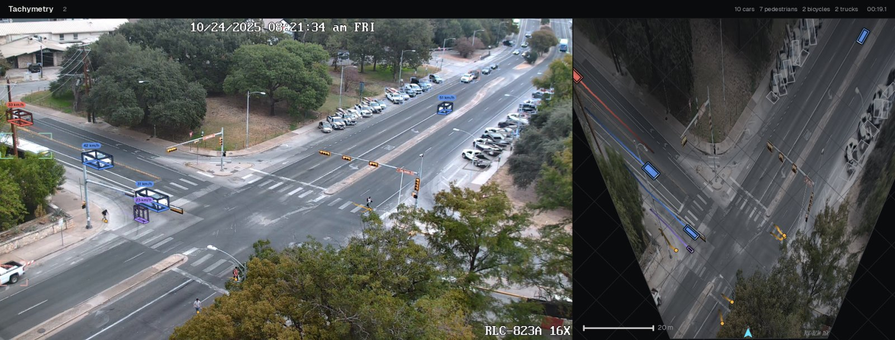
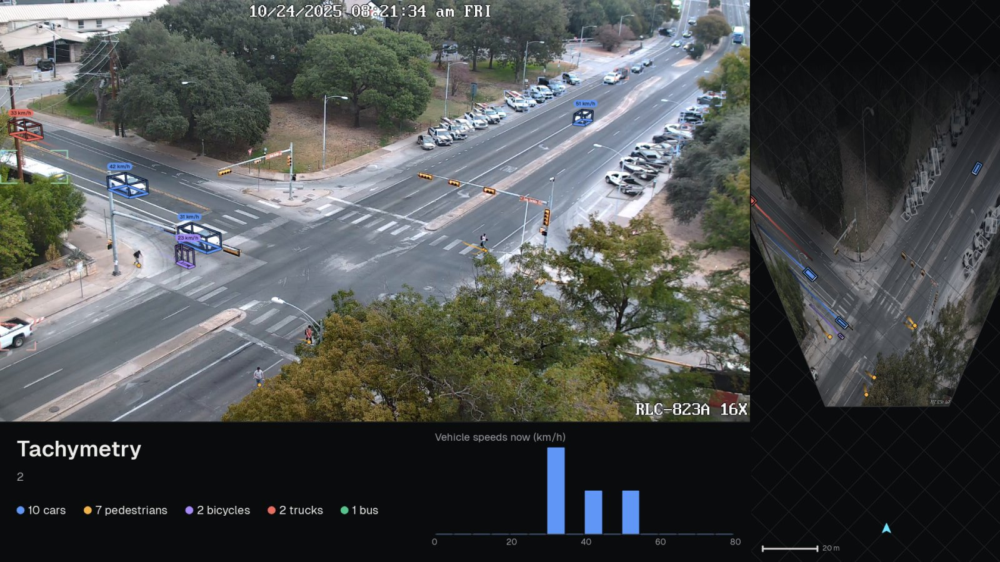
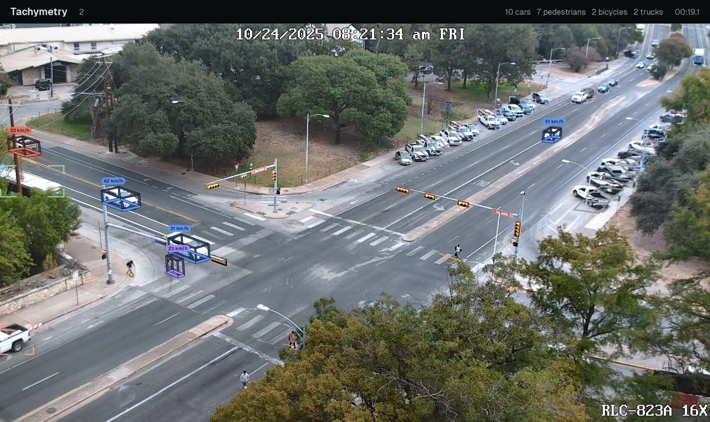
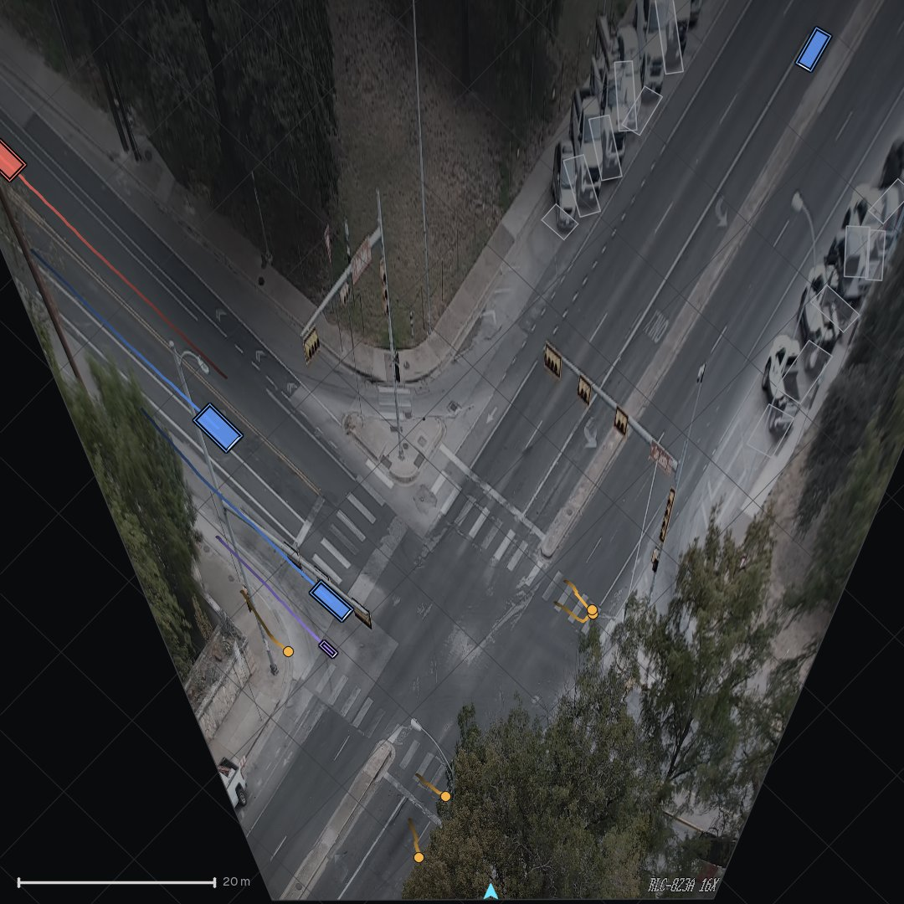

# Rendering

The renderer (`render/video.py`) draws the `ok` tracks of a run onto the source video in one of four layouts and writes an H.264 MP4. Rendering reads the source video again and needs no GPU. Track states are interpolated to each video frame (`render.state.StateIndex`), so the overlay runs at the source frame rate even when tracking ran at `rate_hz = 15`.

## Layouts

| Layout | Frame size for a 1920×1080 source (default `max_width = 1920`) | Content |
|---|---|---|
| `side` (default) | 1920 × 730 | camera view and a square bird's-eye view of the same height, under a 40 px header |
| `dashboard` | 1920 × 1080 | camera view (1440 × 810), bird's-eye column on the right, counts and a live speed histogram below |
| `camera` | 1920 × 1144 | camera view under a 64 px header |
| `bev` | 1080 × 1080 | bird's-eye view only (side `min(max_width, 1080)`) |

In `side`, the camera view is scaled by $\min(1, (\texttt{max\_width} - 2)/(w + h))$ so that camera view and square bird's-eye view together fit `max_width`.

=== "side"

    

=== "dashboard"

    

=== "camera"

    

=== "bev"

    

## What is drawn

* **Vehicles and two-wheelers** as metric boxes of the track's length, width and height, placed at the smoothed footprint centre with the smoothed heading and projected through the calibrated camera and lens (`render.overlay.draw_camera_overlay`). The box is computed from the track, not copied from the detector's output: for vehicles on the mask path its dimensions are the fitted box ([Vehicle footprints from masks](footprints.md)), otherwise the class priors or cuboid estimates, so it is drawn for box-only detectors as well. `draw = "box"` draws the detection box instead and `draw = "footprint"` only the ground rectangle; `auto` (default) draws the 3D box.
* **Pedestrians** as dots at their ground position.
* **Trails**: the recent ground path of moving objects (the last 40 % of `trail_s = 3.0` s in the camera view, the full window in the bird's-eye view), fading towards the oldest end.
* **Speed labels** on moving objects whose image box is at least 22 px high (scaled with resolution), at most 14 per frame, largest boxes first. `show_ids = True` prefixes the track id.
* **Parked vehicles** in a muted grey without speed (`show_parked = True`).
* **Detections without a metric track** as corner brackets without a speed (`show_detections = True`).
    - *What is bracketed.* Detections with a score of at least 0.4 whose rows belong to no track, or only to a track rejected as `invalid` by the kinematic validity checks. Typical cases are distant traffic beyond `hygiene.max_gsd_m` and short or truncated associations.
    - *What is not.* Rows of ghost, duplicate, shadow, passenger and rider tracks stay hidden.
    - *Drawing.* Each bracket is a corner mark a quarter of the box side long, in the class colour lightened towards white (55 % colour, 45 % white). Brackets are 2 px wide at 720p and 1080p and $\max(2, \mathrm{round}(h / 540))$ px for frame height $h$. They are drawn in the camera view only, at the processed frame nearest to the rendered time (`render.video.Renderer`).
* **Header and dashboard strip**: cumulative counts of moving road users by class (a track is counted from its first sample on), the title (default: the video file stem) and the video time. The dashboard histogram shows the speeds of the moving vehicles in the current frame in 5 km/h bins from 0 to 80 km/h.

Colour encodes class only (`render/style.py`): car `#6096f6`, bus `#56c48c`, truck `#e86e62`, motorcycle and bicycle `#a78bfa`, pedestrian `#f0b24a`, parked `#9698a0`. The bird's-eye canvas is described in [Bird's-eye view and speed](bev-speed.md#birds-eye-images).

## Settings

`RenderConfig` (`config.py`):

| Field | Default | Meaning |
|---|---|---|
| `layout` | `side` | `side`, `dashboard`, `camera` or `bev` |
| `draw` | `auto` | `auto`, `box`, `cuboid` or `footprint` |
| `units` | `km/h` | `km/h`, `mph` (km/h divided by 1.609344) or `m/s` |
| `show_parked` | `True` | draw parked vehicles in the muted style |
| `show_ids` | `False` | prefix speed labels with track ids |
| `show_detections` | `True` | corner brackets, without speed, for detections that have no metric track |
| `trail_s` | 3.0 | trail length in seconds |
| `max_width` | 1920 | output width limit (pixels) |
| `fps` | `None` | output frame rate; the source rate by default, otherwise one frame in `round(fps_src / fps)` is rendered |
| `crf` | 18 | H.264 constant rate factor |
| `title` | `None` | header title; the video file stem by default |
| `bev_range_m` | `None` | fixed bird's-eye window size in metres; fitted to the trajectories by default |

Videos are encoded with libx264 (`yuv420p`, preset `medium`, `+faststart`, BT.709 colour tags) through the FFmpeg binary bundled with `imageio-ffmpeg`, which plays in browsers and on all three operating systems; OpenCV's `mp4v` writer is the fallback (`io/writer.py`). Odd frame dimensions are padded to even ones.

!!! note "Settings used by `track(render=True)`"
    `Pipeline.run(..., render=True)`, and therefore `tachymetry run --render`, `tachymetry demo` and `tm.track(render=True)`, renders with the run's full `render` configuration, e.g. `--set render.units=mph`. To render a finished run with other settings, use `tachymetry render` or `RunResult.render(cfg=...)` as shown below.

## Command line

```bash
tachymetry render runs/intersection-day --layout dashboard --units mph --ids --start 5 --end 20
```

`tachymetry render RUN_DIR` reloads the run (tracks are rebuilt from the cached detections, see [Pipeline](pipeline.md#reloading-a-run)) and writes `RUN_DIR/overlay_<layout>.mp4` unless `-o` is given. Options: `--layout`, `--units`, `--ids`, `--start` and `--end` (seconds).

## Python

```python
import cv2

import tachymetry as tm
from tachymetry.config import RenderConfig
from tachymetry.render import render_frame

run = tm.load_run("runs/intersection-day")
for layout in ("side", "dashboard", "camera", "bev"):
    img = render_frame(run, 12.0, layout=layout)
    cv2.imwrite(f"frame_{layout}.jpg", img)
    print(layout, img.shape)
run.render("runs/intersection-day/overlay_bev.mp4", layout="bev", start_s=10, end_s=20)
run.render("runs/intersection-day/overlay_mph.mp4", cfg=RenderConfig(units="mph", show_ids=True), end_s=10)
```

```text
side (730, 1920, 3)
dashboard (1080, 1920, 3)
camera (1144, 1920, 3)
bev (1080, 1080, 3)
```

`render_frame(result, time_s, layout, cfg)` returns one annotated frame as a BGR array. `render_video(result, path, layout, cfg, progress, start_s, end_s, fps, crf)` and its shortcut `RunResult.render(path, layout, **kwargs)` write a video; `Renderer(result, cfg, layout).frame(image, t)` renders arbitrary images at time `t`, for example frames of a second camera with the same view. The API is documented in [`tachymetry.render`](../reference/render.md).
