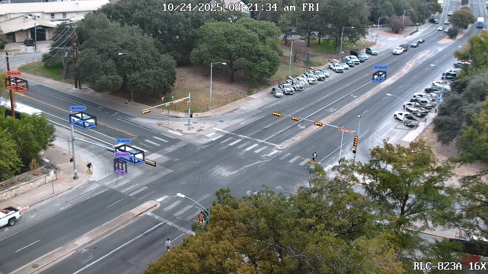

# Tachymetry

Tachymetry converts video from a fixed traffic camera into road-user trajectories on the ground plane: positions in metres, speeds, headings, dimensions and counts per class. It runs detection, camera calibration, association, per-track repair and cross-track verdicts, and exports tables, GeoJSON and annotated videos. Thresholds are expressed in seconds or metres, so one configuration applies across frame rates and resolutions.

<figure markdown>

<figcaption>Public sample clip (svbrd-llm-roadside-video-av, CC BY 4.0) with Tachymetry's output: metric 3D boxes, speeds and ground trails. Parked vehicles are drawn in grey without a speed.</figcaption>
</figure>

## Pipeline

| Stage | What it does | Page |
|---|---|---|
| Detection | SAM 3 (default): text prompts `vehicle` and `person` give boxes and instance masks, class-evidence prompts vote for the vehicle class over each track, and bike detections separate riders from pedestrians. Alternatives: RF-DETR-Seg (boxes and masks), RF-DETR (boxes), UrbanOmniDetect-2 (boxes and 3D cuboid corners). Analysis at 15 Hz by default | [Detection](guide/detection.md) |
| Calibration | Orientation from road-marking and vertical vanishing points or a known field of view, metric scale from vehicle silhouettes, a dash-regularity check; optional depth and segmentation or GeoCalib; manual correspondences; lens distortion included | [Calibration](guide/calibration.md) |
| Association | Two-stage BYTE association with a continuous-time Kalman filter, DIoU cost, shape and super-class gates and a metric speed gate | [Tracking](guide/tracking.md) |
| Vehicle footprints | Calibrated 3D-box silhouettes fitted to the instance masks of each vehicle track: shared dimensions, per-frame pose, occlusion handling, headings of stopped vehicles from the street axes | [Footprints](guide/footprints.md) |
| Track hygiene | Splits at gaps and identity switches, end trimming, Hampel repair, gap-aware zero-phase smoothing, hold-still and parked freezing, validity referees | [Tracking](guide/tracking.md) |
| Verdicts | Stitching of fragments, duplicates, passengers, riders, shadows, ghosts | [Verdicts](guide/verdicts.md) |
| Export and rendering | CSV, JSON, Parquet, GeoJSON, MOT; side, dashboard, camera and bird's-eye layouts | [Outputs](guide/outputs.md), [Rendering](guide/rendering.md) |
| Batch processing | Worker processes pinned to GPUs, longest-first dispatch, resume, failure isolation | [Batch processing](guide/batch.md) |

## Where to start

- [Installation](installation.md) for Linux, Windows, macOS and CPU-only machines.
- [Quick start](quickstart.md): the demo on the public sample clip, then your own videos.
- [Intersection clip, end to end](examples/intersection.md): the full pipeline in Python with the outputs read back.
- [Sample clips](samples.md): the seven public clips, their cameras, licences and results with the default configuration.
- [Drone footage](examples/drone.md): straight-down views with a camera from the flight altitude and the lens's field of view.
- [Synthetic calibration](examples/synthetic-calibration.md) and [Lens rectification](examples/lens-rectification.md): calibration methods and lens models evaluated against known cameras.
- [Benchmarks](benchmarks.md): an ablation of the track-hygiene stages, and box-only against mask geometry, on simulated traffic with ground truth.
- [Limitations](limitations.md): the assumptions behind the metric output and what the filters cannot catch.

## Scope and assumptions

Tachymetry assumes a static camera, a locally planar road and a constant frame rate. Automatic calibration needs two ground directions in the road markings, a known field of view, or GeoCalib, and assumes an oblique view; straight-down drone footage needs a known camera. Positions are footprint centres on the plane $z = 0$; their accuracy degrades with the ground sampling distance, which grows roughly with the square of the range, and ground points imaged coarser than 0.30 m per pixel are discarded by default. These and other limits are discussed in [Limitations](limitations.md).

## License and citation

Tachymetry is released under the Apache License 2.0. Detector weights are not distributed with it: [SAM 3](https://huggingface.co/facebook/sam3), the default, is downloaded under Meta's licence terms after an access request; [RF-DETR](https://github.com/roboflow/rf-detr) weights are Apache-2.0; the optional [UrbanOmniDetect-2](https://huggingface.co/mehmetkeremturkcan/UrbanOmniDetect-2) back-end depends on [Ultralytics](https://github.com/ultralytics/ultralytics), which is licensed AGPL-3.0. The sample clips are downloaded on demand from their hosts (CC BY 4.0 and MIT; see [Sample clips](samples.md)) and are not redistributed. To cite Tachymetry, see [Citation](citation.md).
