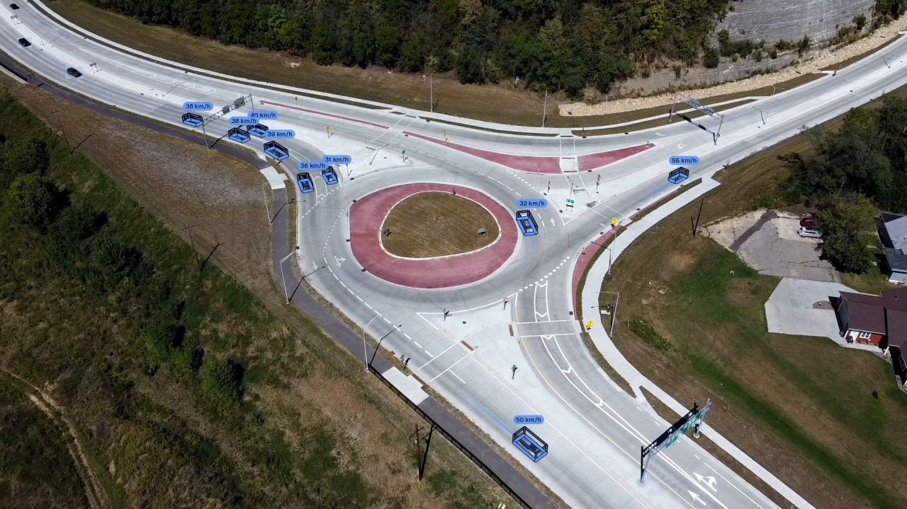

# Sample clips

`tachymetry.data` registers eight public clips for demos, tests and the figures of this documentation. They are downloaded on first use from their original hosts and are not redistributed with Tachymetry. Files hosted on Hugging Face go to the Hugging Face cache. The Wikimedia Commons file and the excerpt go to `$TACHYMETRY_CACHE/samples`, which defaults to `~/.cache/tachymetry/samples`.

| Name | Scene | Camera | Video | Calibration | Licence |
|---|---|---|---|---|---|
| `intersection-day` | signalised urban intersection | elevated pole camera | 1920 x 1080, 30 fps, 31.0 s | automatic | CC BY 4.0 |
| `intersection-day-2` | same intersection, another time of day | same camera | 1920 x 1080, 30 fps, 31.2 s | automatic | CC BY 4.0 |
| `intersection-day-3` | same intersection, dense traffic | same camera | 1920 x 1080, 30 fps, 74.0 s | automatic | CC BY 4.0 |
| `intersection-turn` | same intersection, turning traffic | same camera | 1920 x 1080, 30 fps, 6.6 s | automatic | CC BY 4.0 |
| `intersection-night` | same intersection, infrared night view | same camera | 1920 x 1080, 30 fps, 18.5 s | automatic | CC BY 4.0 |
| `roundabout-aerial` | roundabout | hovering drone, oblique | 1920 x 1080, 23.976 fps, 36.4 s | automatic | CC0 1.0 |
| `motorway-overpass` | divided motorway | camera on an overpass | 1280 x 720, 25 fps, 42.4 s | automatic | MIT |
| `dhaka-roundabout` | dense mixed traffic at a roundabout | drone, straight down | 3840 x 2160, 23.976 fps, 31.1 s | known camera from the flight altitude | CC BY 4.0 |

The video properties are those reported by `tachymetry.io.VideoSource`; all eight files are read by the OpenCV backend.

## Sources and attribution

`tachymetry.data.attribution(name)` returns the credit line that each licence requires.

| Samples | Source | Credit | Licence |
|---|---|---|---|
| `intersection-*` | [svbrd-llm-roadside-video-av](https://huggingface.co/datasets/Ryan-xiangyu-ut/svbrd-llm-roadside-video-av) | Ryan-xiangyu-ut (Hugging Face) | [CC BY 4.0](https://creativecommons.org/licenses/by/4.0/) |
| `roundabout-aerial` | [Roundabout 14 61](https://commons.wikimedia.org/wiki/File:Roundabout_14_61.webm) | Wikideas1 (Wikimedia Commons) | [CC0 1.0](https://creativecommons.org/publicdomain/zero/1.0/) |
| `motorway-overpass` | [Small-Crowd-and-Traffic-Video-Footages](https://huggingface.co/datasets/parsafaramarzi/Small-Crowd-and-Traffic-Video-Footages), `cartraffic03.mp4` | parsafaramarzi (Hugging Face) | MIT |
| `dhaka-roundabout` | [DRINF: Dhaka Road Intersection Nadir Footage](https://huggingface.co/datasets/hamimmahmud0/DRINF), doi:10.57967/hf/10301; a 30 s excerpt from 2:20 of a 15 min recording | Hamim Mahmud (Hugging Face) | [CC BY 4.0](https://creativecommons.org/licenses/by/4.0/) |

The excerpt of `dhaka-roundabout` is cut from the remote file with HTTP range requests and an FFmpeg stream copy. Only about 390 MB are transferred, and the video is not re-encoded. The credits for the footage in the trailer are listed in [docs/media/CREDITS.md](https://github.com/mkturkcan/tachymetry/blob/main/docs/media/CREDITS.md).

## Running a sample

```bash
tachymetry demo                                  # intersection-day
tachymetry demo --sample roundabout-aerial -o runs/roundabout
tachymetry demo --sample dhaka-roundabout -o runs/dhaka
```

`tachymetry demo` prints the sample's attribution, then runs detection, calibration, tracking, export and rendering. Samples that carry a known camera use it instead of automatic calibration, together with the configuration overrides they need. In this release that applies only to `dhaka-roundabout`. The drone clip and the reasons for its known camera are covered in [Drone footage](examples/drone.md).

```python
from tachymetry.data import SAMPLES, attribution, sample_camera, sample_overrides, sample_video

for name, s in SAMPLES.items():
    cam = sample_camera(name)
    print(f"{name:20s} {s.license:9s} {'known camera' if cam is not None else 'automatic':12s} {sample_overrides(name)}")

path = sample_video("motorway-overpass")         # local path, downloaded once
print(attribution("motorway-overpass"))
```

Output:

```text
intersection-day     CC BY 4.0 automatic    {}
intersection-day-2   CC BY 4.0 automatic    {}
intersection-day-3   CC BY 4.0 automatic    {}
intersection-turn    CC BY 4.0 automatic    {}
intersection-night   CC BY 4.0 automatic    {}
roundabout-aerial    CC0 1.0   automatic    {}
motorway-overpass    MIT       automatic    {}
dhaka-roundabout     CC BY 4.0 known camera {'detector.imgsz': 2560}
Small-Crowd-and-Traffic-Video-Footages by parsafaramarzi (Hugging Face), MIT, https://huggingface.co/datasets/parsafaramarzi/Small-Crowd-and-Traffic-Video-Footages
```

## Results with the default configuration

Summaries of one run per clip: the default configuration with `camera="auto"`, except `dhaka-roundabout`, which uses its known camera and `detector.imgsz = 2560`. Counts are accepted tracks (`summary.json`, `summary.tracks`). Speeds are the median and 85th percentile over the samples above 3 km/h of moving car, bus and truck tracks (`summary.vehicle_speed_kmh`).

| Name | Calibration | Camera | Tracks | Median speed (km/h) | p85 speed (km/h) |
|---|---|---|---|---|---|
| `intersection-day` | `auto:fused` | f = 2212 px, height 27.8 m, pitch 17.9° | 44 | 25.0 | 36.0 |
| `intersection-day-2` | `auto:fused` | f = 2298 px, height 29.1 m, pitch 17.4° | 41 | 32.6 | 45.2 |
| `intersection-day-3` | `auto:fused` | f = 2314 px, height 29.2 m, pitch 17.4° | 91 | 25.9 | 43.5 |
| `intersection-turn` | `auto:fused` | f = 2079 px, height 25.1 m, pitch 17.2° | 23 | 21.2 | 28.4 |
| `intersection-night` | `auto:lines` | f = 2108 px, height 32.7 m, pitch 21.3° | 7 | 47.8 | 62.1 |
| `roundabout-aerial` | `auto:fused` | f = 1518 px, height 75.9 m, pitch 34.7° | 18 | 36.7 | 51.7 |
| `motorway-overpass` | `auto:fused` | f = 2072 px, height 15.3 m, pitch 9.8° | 45 | 94.4 | 122.5 |
| `dhaka-roundabout` | known | f = 2825 px, height 111.7 m, pitch 90° | 286 | 11.8 | 15.9 |

The five intersection clips come from one PTZ camera, recorded on three different days, so its zoom and pose may differ between them. The four daytime calibrations span focal lengths of 2079 to 2314 px (11 %), heights of 25.1 to 29.2 m and pitches of 17.2° to 17.9°. This spread bounds the calibration error only if the camera did not move between recordings. For the infrared night clip the `lines` candidate scored highest (0.328, against 0.317 for `fused` and 0.170 for `cuboids`; `camera.report.json`); see [Limitations](limitations.md#night-and-low-light).

<figure markdown="span">
  
  <figcaption>`roundabout-aerial` with Tachymetry's output: metric 3D boxes, speeds and trails. Stills of all eight clips are generated by `python tools/make_docs_media.py --only gallery` into `docs/media/gallery/` and shown on the project page.</figcaption>
</figure>
