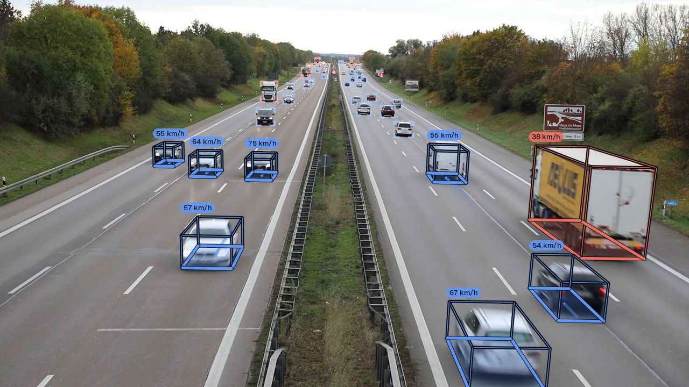

# Sample clips

`tachymetry.data` registers seven public clips for demos, tests and the figures of this documentation. They are downloaded on first use from their original hosts and are not redistributed with Tachymetry. Files hosted on Hugging Face go to the Hugging Face cache; the excerpt goes to `$TACHYMETRY_CACHE/samples`, which defaults to `~/.cache/tachymetry/samples`.

| Name | Scene | Camera | Video | Calibration | Licence |
|---|---|---|---|---|---|
| `intersection-day` | signalised urban intersection | elevated PTZ camera | 1920 x 1080, 30 fps, 31.0 s | automatic, with the 47.5° field of view registered for the sample | CC BY 4.0 |
| `intersection-day-2` | same intersection, another time of day | same camera | 1920 x 1080, 30 fps, 31.2 s | shared camera file | CC BY 4.0 |
| `intersection-day-3` | same intersection, dense traffic | same camera | 1920 x 1080, 30 fps, 74.0 s | shared camera file | CC BY 4.0 |
| `intersection-turn` | same intersection, turning traffic | same camera | 1920 x 1080, 30 fps, 6.6 s | shared camera file | CC BY 4.0 |
| `intersection-night` | same intersection, infrared night view | same camera | 1920 x 1080, 30 fps, 18.5 s | shared camera file | CC BY 4.0 |
| `motorway-overpass` | divided urban expressway | camera on an overpass | 1280 x 720, 25 fps, 42.4 s | automatic, with the 59° field of view registered for the sample | MIT |
| `dhaka-roundabout` | dense mixed traffic at a roundabout | drone, straight down | 3840 x 2160, 23.976 fps, 31.1 s | known camera from the flight altitude | CC BY 4.0 |

The video properties are those reported by `tachymetry.io.VideoSource`; all seven files are read by its OpenCV backend.

**Cameras.**

- **Intersection.** The five intersection clips come from one camera pose; their backgrounds register to each other within 4.2 px (the infrared night clip up to 12.4 px at the image corners). `intersection-day` is calibrated automatically with a 47.5° field of view, which GeoCalib estimated on four of the clips. The other four load that camera from the package (`tachymetry/assets/cameras/svbrd-intersection.json`), because calibrating each clip separately adds the per-clip variance of automatic calibration ([Calibration verification](guide/calibration.md#calibration-verification)).
- **Motorway.** The 59° field of view of `motorway-overpass` is checked by its lane markings. Under the resulting camera, the five dashes of the chain found on the road measure 2.85 to 3.16 m, with a dash-regularity spread of 0.019 (`docs/media/calib_dashes.jpg`), consistent with urban-expressway markings.
- **Drone.** The straight-down camera of `dhaka-roundabout` comes from its flight log ([Drone footage](examples/drone.md)).

## Sources and attribution

`tachymetry.data.attribution(name)` returns the credit line that each licence requires.

| Samples | Source | Credit | Licence |
|---|---|---|---|
| `intersection-*` | [svbrd-llm-roadside-video-av](https://huggingface.co/datasets/Ryan-xiangyu-ut/svbrd-llm-roadside-video-av) | Ryan-xiangyu-ut (Hugging Face) | [CC BY 4.0](https://creativecommons.org/licenses/by/4.0/) |
| `motorway-overpass` | [Small-Crowd-and-Traffic-Video-Footages](https://huggingface.co/datasets/parsafaramarzi/Small-Crowd-and-Traffic-Video-Footages), `cartraffic03.mp4` | parsafaramarzi (Hugging Face) | MIT |
| `dhaka-roundabout` | [DRINF: Dhaka Road Intersection Nadir Footage](https://huggingface.co/datasets/hamimmahmud0/DRINF), doi:10.57967/hf/10301; a 30 s excerpt from 2:20 of a 15 min recording | Hamim Mahmud (Hugging Face) | [CC BY 4.0](https://creativecommons.org/licenses/by/4.0/) |

The excerpt of `dhaka-roundabout` is cut from the remote file with HTTP range requests and an FFmpeg stream copy. Only about 390 MB are transferred, and the video is not re-encoded. The credits for the footage in the trailer are listed in [docs/media/CREDITS.md](https://github.com/mkturkcan/tachymetry/blob/main/docs/media/CREDITS.md).

## Running a sample

```bash
tachymetry demo                                  # intersection-day
tachymetry demo --sample motorway-overpass -o runs/motorway
tachymetry demo --sample dhaka-roundabout -o runs/dhaka
```

`tachymetry demo` prints the sample's attribution, then runs detection, calibration, tracking, export and rendering with the camera or configuration overrides registered for the sample.

```python
from tachymetry.data import SAMPLES, attribution, sample_camera, sample_overrides, sample_video

for name, s in SAMPLES.items():
    cam = sample_camera(name)
    print(f"{name:20s} {s.license:9s} {'known camera' if cam is not None else 'automatic':12s} {sample_overrides(name)}")

path = sample_video("motorway-overpass")         # local path, downloaded once
print(attribution("motorway-overpass"))
```

Output:

```text
intersection-day     CC BY 4.0 automatic    {'calibration.hfov_deg': 47.5}
intersection-day-2   CC BY 4.0 known camera {}
intersection-day-3   CC BY 4.0 known camera {}
intersection-turn    CC BY 4.0 known camera {}
intersection-night   CC BY 4.0 known camera {}
motorway-overpass    MIT       automatic    {'calibration.hfov_deg': 59.0}
dhaka-roundabout     CC BY 4.0 known camera {'hygiene.small_vehicle_rule': True}
Small-Crowd-and-Traffic-Video-Footages by parsafaramarzi (Hugging Face), MIT, https://huggingface.co/datasets/parsafaramarzi/Small-Crowd-and-Traffic-Video-Footages
```

## Results with the default configuration

One run per clip with the default configuration (SAM 3, 15 Hz) and the camera or overrides registered for the sample. The run is reproduced by `python tools/make_docs_media.py --only gallery`, which also writes `docs/media/figures.json`.

- **Tracks** counts the accepted tracks (`summary.json`, `summary.tracks`).
- **Speeds** are the median and 85th percentile over the samples above 3 km/h of moving car, bus and truck tracks (`summary.vehicle_speed_kmh`).

| Name | Camera | Tracks | Tracks by class | Median speed (km/h) | p85 speed (km/h) |
|---|---|---|---|---|---|
| `intersection-day` | f = 2182 px, height 27.4 m, pitch 17.9° | 50 | 30 car, 8 truck, 2 bus, 2 bicycle, 8 person | 24.7 | 34.5 |
| `intersection-day-2` | shared camera | 49 | 34 car, 7 truck, 6 bus, 2 person | 31.1 | 43.1 |
| `intersection-day-3` | shared camera | 115 | 57 car, 18 truck, 3 bus, 3 bicycle, 34 person | 25.7 | 41.8 |
| `intersection-turn` | shared camera | 32 | 27 car, 2 truck, 3 person | 20.3 | 27.6 |
| `intersection-night` | shared camera | 8 | 8 car | 50.1 | 65.6 |
| `motorway-overpass` | f = 1131 px, height 8.4 m, pitch 11.8° | 70 | 61 car, 9 truck | 61.8 | 78.7 |
| `dhaka-roundabout` | f = 2825 px, height 111.7 m, pitch 90° | 314 | 45 car, 8 truck, 208 motorcycle, 21 bicycle, 32 person | 10.8 | 16.6 |

The shared intersection camera is an earlier automatic calibration of `intersection-day`: f = 2182 px, 27.7 m high, pitched 17.9° down, roll −0.18°. The clip's current automatic calibration is 1 % lower ([one camera, several clips](guide/calibration.md#one-camera-several-clips)).

- **Truck labels.** Vehicle classes come from SAM 3's class-evidence prompts, voted over each track ([class vote](guide/tracking.md#class-vote)). The `truck` prompt scores pickups higher than `car` (0.7 to 0.9 against 0.5 to 0.7), so the eight truck tracks of `intersection-day` are seven pickups and a utility trailer.
- **Two-wheelers in mixed traffic.** In `dhaka-roundabout`, 175 motorcycles are classed from `motorcycle` evidence. The clip's override `hygiene.small_vehicle_rule` makes two-wheelers of 51 tracks without usable evidence, nearly all of them cycle-rickshaws and rickshaw vans, which would otherwise be cars: 18 bicycles and 33 motorcycles ([Drone footage](examples/drone.md#cycle-rickshaws)). The other 3 of the 21 bicycles are cyclists inferred from fast person tracks, and 34 person tracks are riders, 31 of them on a tracked two-wheeler ([Limitations](limitations.md#mixed-traffic-and-class-dependent-scale)).
- **Motorway speeds.** Moving vehicles on the motorway have a median speed of 61.8 km/h. Under the selected camera (8.4 m high), the five dashes of the checked chain measure 2.85 to 3.16 m with periods of 8.9 to 9.4 m, the 3 m dashes and 6 m gaps of the markings. An earlier cuboid-based calibration of this clip, without a known field of view, gave about 95 km/h; under that camera the dashes of the same chain grow from 3.35 m to 6.28 m along the road (spread 0.165). The dash check is what exposes such a calibration.

<figure markdown="span">
  
  <figcaption>`motorway-overpass` with Tachymetry's output: metric 3D boxes, speeds and trails, and corner brackets for detections beyond the metric range. Stills of all seven clips are written to `docs/media/gallery/` and shown on the project page.</figcaption>
</figure>
